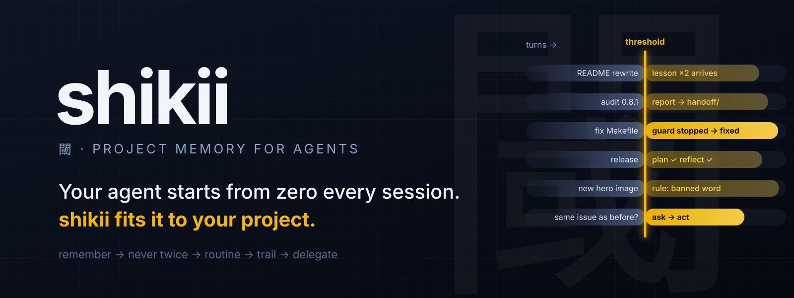
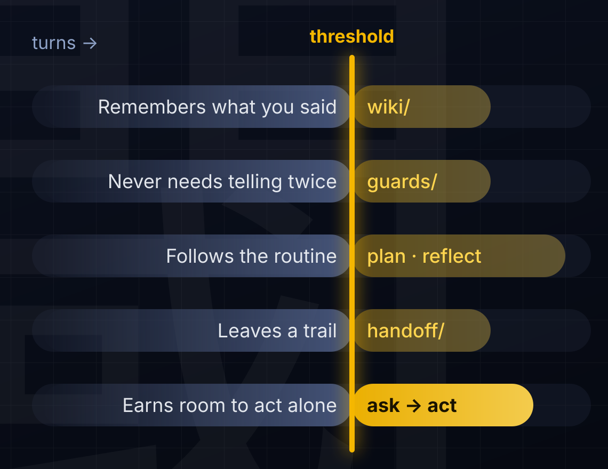
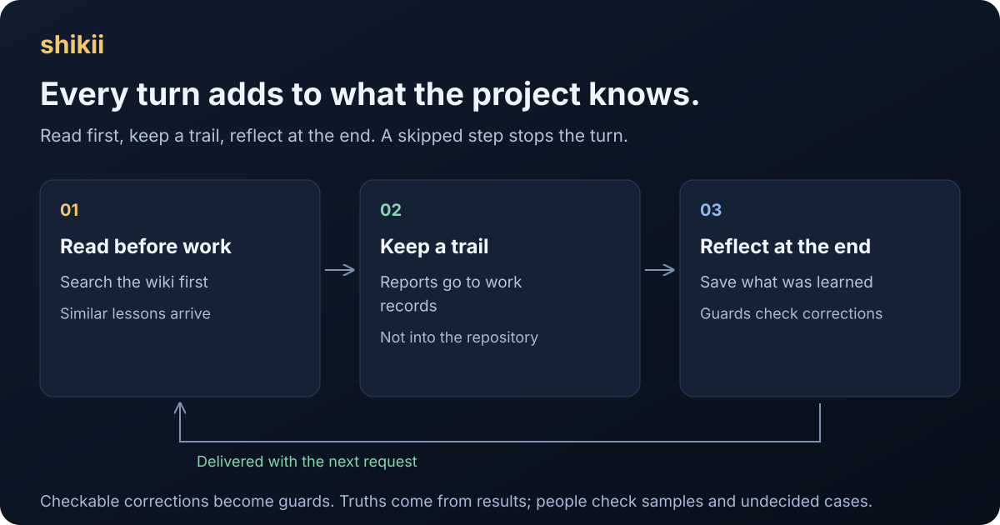
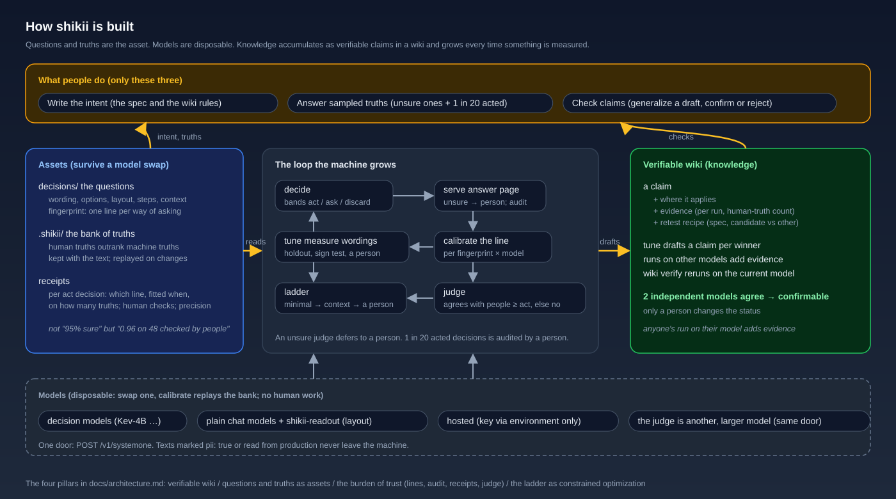

**English** · [日本語](docs/readme/README_ja.md)

<p align="center"></p>

# shikii: grow your agent to fit your project

AI agents can carry context forward through memory. A project also needs to use that experience at the right moment, review whether it helped, and measure which decisions to delegate. shikii connects these steps: it keeps what was said, decided and checked in `.shikii/`, delivers relevant knowledge, and feeds results back into future work. What grows is the project, not the model, so its knowledge remains when you change models.

**It remembers what you said, never needs telling twice, and earns room to act alone.**

[](go.mod)
[](.github/workflows/test.yml)
[](LICENSE)
[](docs/decision-ops-framework.md)
[](CHANGELOG.md)

Version 0.43.2 shortens the wait for shikii before and after each request in projects with many past requests, and stops `shikii init` from deleting an unchanged skill for a moment. Version 0.43.1 makes OpenCode give the agent the memory nap request with the request you just sent when you reopen an earlier conversation and carry on, instead of on the first request of the conversation, where the agent took it as old text. Version 0.43.0 makes `shikii nap` count how many missed corrections a review caught, shown in its output and in `shikii status`, and moves the review on only past the conversations the agent says it has read, so the rest come again next time. Version 0.42.0 adds `shikii nap`, the memory nap: at most once a day, the agent reviews its memory (the wiki's articles). It rereads articles whose underlying files changed, and adds the corrections and rules you recently gave that the wiki does not hold yet. Version 0.41.0 adds `shikii forget`, which removes what finished agent sessions, such as trial runs, left in a project's `.shikii/`; from MCP it asks you directly before removing anything. It also adds `shikii wiki withdraw`, with which a tool such as chiten takes back the articles it made from work you removed; a withdrawn article is kept until you restore or delete it on the answer page. Version 0.40.2 records which OpenCode session ran a `shikii wiki query` that found nothing, as 0.40.1 began doing for Claude Code and Codex. Version 0.40.1 makes wiki searches faster and lets an agent review up to 10 articles at a time when it moves old memory into the wiki. Version 0.40.0 adds the ready-made question quote-supports, which a tool such as chiten asks to learn whether a passage supports a claim, and lets each project choose whether TypeSafe's Jev or the local model answers its decisions, on the Settings page or with `shikii init --model`. Version 0.39.0 makes a search that finds nothing more useful: when a search of several words finds nothing, the reply names the words that find an article alone, and the pointer for words that found nothing before leads only to a work record that speaks of the words searched. Version 0.38.0 passes on what a task left: what an agent writes as left in its work record reaches the next task when it starts, and words the wiki could not answer are remembered, so a later search of the same words is pointed to the record of the task that was open when they found nothing. Version 0.37.4 lets the hooks remember where the repository is in a git worktree, in a submodule and in a repository whose git folder is kept elsewhere too, so a request starts 3 git processes there as well instead of 4, and a tool call none instead of 1. Version 0.37.3 makes the hooks start git much less often: they ask where the repository is once and remember the answer, so a request starts 3 git processes instead of 11 and a tool call none. Version 0.37.2 gives a subagent, when it starts, only the rules that apply to every request, instead of lessons chosen from the text of its task: in this project's records those lessons were rarely useful to the subagent. A subagent still looks up what its task needs in the wiki. Version 0.37.0 let an agent working in a worktree kept under a project (Claude Code's `.claude/worktrees/`, chiten's `.chiten/wt/` and the like) use that project's wiki, guards and records: shikii now takes the nearest folder above that was initialized on this machine as the project. See the [changelog](CHANGELOG.md) and [how shikii relates to memory](docs/memory-and-learning.md).

[The problem](#the-problem) · [What grows](#what-grows) · [What you do](#what-you-do) · [Requirements](#requirements) · [Get started](#get-started) · [How it works](#how-it-works) · [Delegate business decisions](#delegate-business-decisions) · [Memory belongs to a project](#memory-belongs-to-a-project) · [Read more](#read-more)

<p align="center"></p>

## The problem

Hand work to an agent and this tends to happen:

- You corrected it once and you are correcting the same thing in the next job.
- You wrote the lesson down, but you cannot tell whether the agent read it, or whether reading it changed anything.
- The subagents it spawns never see that lesson at all.
- It starts work without checking what was already decided, and forgets to write down what it learned.
- Its reports, notes and screenshots pile up in the repository, or are lost when the session ends.
- Nobody has measured how far you can trust its “probably, 0.9”.

If you repeat the same explanations and corrections every time, there was little point in handing the work over.

## What grows

Like someone who has worked on the project for a long time, the agent picks up five things. What grows is the project's `.shikii/`, not the model.

<p align="center"></p>

| What grows | What shikii does |
|---|---|
| It remembers what you said | Corrections and decisions become lessons with sources and arrive before similar work |
| It never needs telling twice | Corrections a machine can check become guards that check the turn at its end, and refuse a command right before it runs |
| It follows the routine | Before a request it gathers what the agent needs; before the agent ends, it has the result and what was learned saved. A missing step stops the turn |
| It leaves a trail | Reports, release logs, diffs and screenshots go to work records you read on the page |
| It earns room to act alone | As truths accumulate, a line is drawn above which the model is right often enough, and more decisions go ahead without asking |

1. **It remembers what you said.** From the requests, replies and corrections of ordinary conversations, the agent writes lessons with sources into the wiki. Each lesson carries a kind (a rule decided in this project, a how-to, criteria for a choice, a fact or assumption, or history) and a scene written in the words of that work ("when committing", "when sending an invoice"). Before a lesson is saved, the decision model finds the page it belongs to and checks it against earlier lessons. One topic stays in one page. Up to two relevant lessons arrive before similar requests. In Claude Code and Codex they also arrive right before the agent changes a file or runs a command that a lesson names. A subagent gets the rules for every request when it starts, and in Claude Code and Codex the lessons that name a command or file right before it runs them. History lessons are read only when searched for. Rules, tests and procedures the agent makes or changes itself also go into the wiki right away, without being asked.
2. **It never needs telling twice.** Corrections a machine can check (“keep both changelogs in step”, “never use that word”, “write the original problem and the verification in the commit body”) become guards. When one fails, the agent cannot end the turn until it fixes the work. A guard on commands, such as “no push until allowed”, refuses the command right before it runs in Claude Code and Codex.
3. **It follows the routine.** When a request arrives, the hook gathers the request, what the conversation so far has agreed and left open, the relevant lessons and the pages waiting for review, and hands them to the agent. The agent reads them before it works, and when the topic moves it searches the wiki again with words it picks. Before it ends, it saves in one call the result, whether the delivered lessons helped, and what it learned. What it records as left reaches the next task when that task starts, and when words it searched the wiki for find nothing, a later search of the same words is pointed to a work record that speaks of the words searched. When a search of several words finds nothing, the reply names the words that find an article alone. If it tries to end without saving, shikii returns the operation to run. When the remaining work shrinks, it is asked to continue; when it does not, the turn ends marked incomplete and automatic continuing stops. These checks are built in and always on, also in projects without `CLAUDE.md` or `AGENTS.md`.
4. **It leaves a trail.** Audit reports, release steps, diffs and screenshots that the agent keeps editing go to `.shikii/handoff/<task>/`, and subagents are told to write their reports there too. They are not committed; you read them on the page under Knowledge → Work records.
5. **It earns room to act alone.** A model returns a probability, “probably 0.9”. From the truths people and results supply, shikii measures how the model's confidence relates to how often it is right, and draws a line above which it may act on its own. Until the line exists, nothing is automatic. Every decision falls into one of four bands: `act` proceeds automatically, `ask` goes to a person, `discard` does nothing, `abstain` means an input or an endpoint is missing. When a line is drawn, or when there are enough truths but no line can be drawn (only one answer so far, the answers cannot be told apart, or the question was stopped because they cannot), you are told once at the end of a turn. Truths live apart from the model, so changing models does not start you over. Alternative wordings can be scored on the same truths and the better one kept: the agent checks that it still asks the same thing and translates both into your language when it is not English, the new wording is switched in, and you are told with the translations and can undo it (when the agent cannot decide, you are asked).

The AI part of the page and `shikii status` show whether it is working: whether delivered lessons helped, how many turns did the routine, how many turns guards stopped and how many were fixed, how many decisions wait for a person, and which lines have been drawn.

## What you do

- **Correct your agent as usual.** “There is still English left” in an ordinary conversation is enough. The agent files it as a lesson and shikii keeps it next to the right page. When the correction can be checked by a machine, the agent also drafts a guard, disabled.
- **Enable guards.** Run `shikii guard enable <id>` once. shikii first shows the guard stopping on a deliberately broken example and passing on a correct one, then enables it. Disabling is also your call.
- **Answer some questions.** Under Answer on the page, the decisions the model was unsure about and 1 in 20 of the ones it acted on appear one card at a time. The count waiting is shown beside Answer. Read the conversation and press the button for what was actually true.
- **Look up knowledge when you need it.** At the top of the page's Knowledge section, "Always keep" lists the rules decided in this project, by people or by the AI, so none gets buried; new rules are marked "new". Below it, pick a scene to see the lessons for it grouped by kind, and press a title to read it. You do not need to check everything: "For you to look at" shows only the exceptions, such as a lesson that did harm or a correction that was repeated.
- **Edit or delete knowledge.** Open an article and choose Edit or Delete. Deletion removes it from search and delivery, while its sources and history remain. Past answers of yours that the AI judged not useful are listed under "Past answers the AI judged not useful", where you can undo that.
- **Read the work records when you want.** On the page, under Knowledge → Work records, you can read the agent's reports and see its screenshots.
- **Check a wording when it changes.** When the agent changes how a question is asked, a notice appears under Answer. Choose "Keep it" or "Undo". When the agent could not decide whether the meaning is the same, you choose there too.
- **Ask for a tidy-up when you want.** Ask the agent to "tidy shikii": it checks the wiki's wording against its sources and corrects overstatement and repeated explanations, keeping meaning, conditions, exceptions and history.
- **Ask for a memory optimization when you want.** Ask the agent to "optimize shikii" (optimize the memory): in that same turn it first tidies every wiki page waiting for the memory upgrade, then reviews each against its original sources for the current version's way of writing (the memory upgrade). A page whose sources cannot be read is skipped with the reason recorded. Ask to "tidy shikii" for the tidy-up alone, or to "upgrade the memory" for the upgrade alone.

Everything else is the machine's job.

## Requirements

| Use case | What you need |
|---|---|
| Learn from ordinary conversations and turn corrections into guards | Claude Code, Codex or OpenCode 2.x, shikii, and `shikii --init` in the projects you choose. Lessons reach subagents too |
| Answer the built-in questions | Recommended: TypeSafe Jev with `TYPESAFE_API_KEY` in the environment, nothing to download. Without an API key: llama.cpp (`llama-server`) and Ternary-Bonsai-27B through `shikii up`, about 7.6 GB to download and 10 GB of memory while running |
| Use another model for business decisions | Any System One endpoint from the table below |
| Install | macOS or Linux (amd64 or arm64), sh, curl, tar, awk, and shasum or sha256sum (both systems have them). Go is not needed |
| Install from source | Go 1.27 or newer, Git and sh. The page is bundled; Node.js is not needed |
| Run the business API and page in containers | Docker with Compose, or Podman with a Compose provider ([setup](integrations/docker.md)) |
| Try the whole loop without an API key or GPU | Go 1.27 or newer and the included fake model (`scripts/demo.sh`) |

| Endpoint | What it needs |
|---|---|
| Jev (TypeSafe AI) | Recommended. `TYPESAFE_API_KEY`. The built-in questions and every business decision whose `send_to` allows `hosted` go here when the API key is set. [Official API](https://docs.typesafe.ai/introduction/quickstart) |
| llama.cpp | Without an API key. Any chat GGUF through the included `shikii-readout` (the local standard is Ternary-Bonsai-27B; `shikii up` sets both up). Trained decision models such as OpenJev are passed through. Kev-4B is not supported. [Examples](integrations/readout.md) |
| Ollama / LM Studio | Their `/v1/systemone` endpoints with a decision model, for business decisions. Not tested in this release |

## Get started

### 1. Put a TypeSafe API key in the environment (recommended)

Get an API key from [TypeSafe AI](https://docs.typesafe.ai/introduction/quickstart) and put it in the environment of your shell and your agent (`export TYPESAFE_API_KEY=…`). Nothing is downloaded and an ordinary PC is enough. With the API key, the hooks and the built-in questions go to Jev and no local model is started (`shikii up` does not start one either). The request text, the agent's reply and wiki lessons are sent to TypeSafe for the built-in questions; they also stay in the local records. `SHIKII_MODEL=local` keeps a local model even with an API key; `SHIKII_MODEL=hosted` forces Jev. A project can choose for itself on its page (Settings in the menu), or with `shikii init --model local` (its requests, replies and file excerpts stay on this machine even with a key; the hooks start the local model for it) or `shikii init --model hosted`. The choice is kept in `.shikii/project.json`, comes before `SHIKII_MODEL` and the API key, and running `shikii init` again without `--model` keeps it.

**Without an API key: llama.cpp.** shikii then runs a local model. It is a 27B model that needs about 10 GB of memory while running, which can be heavy for an ordinary PC. On macOS with Homebrew:

```sh
brew install llama.cpp
llama-server --version
```

For other systems, see [llama.cpp's installation guide](https://github.com/ggml-org/llama.cpp/blob/master/docs/install.md). The default local model is **Ternary-Bonsai-27B Q2_g64** (`prism-ml/Ternary-Bonsai-27B-gguf`, Apache 2.0, about 7.6 GB to download and 10 GB of memory while running). `shikii up` starts llama-server on :8086 and `shikii-readout` on :8080, so hooks, MCP and the page always talk to :8080. Any other GGUF works the same way (`shikii up --gguf <file>`).

### 2. Install shikii

```sh
curl -fsSL https://raw.githubusercontent.com/hayaenfj/shikii/main/install.sh | sh
```

The installer downloads the latest release for your machine (macOS or Linux, amd64 or arm64) from GitHub Releases, checks it against the release's `SHA256SUMS`, and puts `shikii` and `shikii-readout` in `~/.local/bin`. It asks GitHub which release is the latest, so it gets a release as soon as it is published, and it does not need Go. It adds the binaries, the hooks (before a turn, after it, when a subagent starts and ends, and right before a file edit or a command) and the agent's instructions, and says when the binary directory must be added to PATH. In Codex, trust the hooks with `/hooks`, and again whenever they change (after moving the binary or updating shikii); until then Codex skips them.

**With Go 1.27 or newer.** Install both binaries directly into a stable directory:

```sh
mkdir -p "$HOME/.local/bin"
GOBIN="$HOME/.local/bin" go install github.com/hayaenfj/shikii/cmd/shikii@latest
GOBIN="$HOME/.local/bin" go install github.com/hayaenfj/shikii/cmd/shikii-readout@latest
export PATH="$HOME/.local/bin:$PATH"
shikii hook install --yes
```

Keep `~/.local/bin` on PATH in your shell settings, then initialize the projects you choose in step 3. To install a specific release, replace `@latest` in both commands with a tag such as `@v0.34.0`.

If the hooks stop working after you upgrade Go or move the binary, run the installer command above again: the binary itself is often what is gone (with a Go version manager such as mise, a Go upgrade removes the per-version folder `go install` put it in), and `shikii doctor` with it. When `shikii` still runs, `shikii doctor` says when the hooks or the Codex registration point to a shikii binary that no longer exists or cannot run, and how to fix it.

**If an earlier `go install` used Go's default folder.** That binary stays in Go's folder (`$(go env GOPATH)/bin`, or `GOBIN`), and `shikii update` updates it there; it does not move it to `~/.local/bin`. Run the installer command above once: the hooks then run `~/.local/bin/shikii`. Check that `~/.local/bin` is on PATH first (the installer says when it is not): Claude Code's and OpenCode's MCP servers run `shikii` by name. Then remove the old `shikii` and `shikii-readout` from Go's folder by hand, and run `shikii hook install --yes` once more. Until you do, two binaries are installed: `shikii` typed in a terminal, and the MCP servers of Claude Code and OpenCode (which run `shikii` by name), run whichever comes first on PATH (`command -v shikii` shows which), `shikii update` updates only that one, and Codex's MCP registration keeps the old binary while it exists.

**Building from source (for developers).** In a clone of this repository, `sh install.sh` builds the current source with Go 1.27 or newer and puts the binaries in the same `~/.local/bin`, then installs the hooks the same way (`make install` builds and copies the binaries only).

### 3. Initialize the projects you choose

In a project you want to enable, ask your agent:

> Use shikii in this project.

The agent runs `shikii init` (the same as `shikii --init`; you can run it yourself). shikii works only in initialized projects.

What `shikii init` does:

- It creates `.shikii/` in the project, with the built-in questions, the wiki, the place for guards and the folder for work records. `.shikii/` holds private conversations, so it is excluded from Git.
- It adds the MCP setup so the agent can call shikii. It adds `.mcp.json` and `opencode.json` to the project and does not write into `AGENTS.md` or `CLAUDE.md`. For Codex, which reads MCP servers only from the shared `~/.codex/config.toml`, it writes one shared registration without a project, and each tool call names the agent's working folder as `project`. The registration carries `default_tools_approval_mode = "approve"`, so Codex runs shikii's tools without asking before each call. Writing `"prompt"` there, or deleting the line, makes Codex ask again; shikii does not add the line a second time.
- It puts the agent's instructions (the skill) in place.
- For the first project on a machine, when none of shikii's hooks is installed, it installs them too (what `shikii hook install --yes` does; without a TypeSafe API key, and with `llama-server` installed, that starts the local model in the background). On a machine that already has projects and no hooks, it leaves them off and names the command that installs them.
- Running it again gives the same result, and never removes settings or records you wrote.

`shikii init` has nothing to choose, so it takes no arguments such as `--yes` (with one, it refuses and says no arguments are needed). `--yes` belongs to the commands that list their changes first.

| Command | Without `--yes` | With `--yes` |
|---|---|---|
| `shikii hook install` | Only lists the hooks and plugin it would add | Installs them |
| `shikii uninstall` | Only lists what it would remove | Removes it |

The answer page is one per project: the first request's hook starts it on a free port and opens it in the browser (`shikii page` tells you the URL). `shikii doctor` checks the setup.

**OpenCode.** OpenCode 2.x has no hook settings, so `shikii hook install --yes` (and the first `shikii --init` on a machine) puts a small plugin in `~/.config/opencode/plugins/shikii/` (under `$XDG_CONFIG_HOME/opencode/` when that is an absolute path). It runs the same hooks as for Claude Code and Codex: shikii's lessons reach the model before a request, and a required record continues the turn at its end. That end-of-turn check runs inside the turn, through an experimental OpenCode hook (OpenCode 2.3.0), so it runs in the TUI and in `opencode run` alike. An OpenCode that does not run that hook checks only after the turn ends, and `opencode run` with a private server (`--standalone`, or when no background service is running) has exited by then. A folder of yours with the same name is never overwritten and a link is not followed; shikii says so and leaves it. An OpenCode started with `OPENCODE_CONFIG_DIR` reads its plugins only from that folder's `plugins/`, so it does not read shikii's plugin; shikii does not write there, and `shikii doctor` says so. OpenCode 1.x does not read the folder and keeps using only the MCP setup and the skill. shikii's plugin adds no hook before a command, so guards that refuse a command do not run in OpenCode; the turn-end checks do. shikii's plugin does not show text to you either, so the messages shikii shows you in Claude Code and Codex (a guard's explanation, the number of answers waiting, a note that automatic continuing stopped) do not appear in OpenCode. Reopen OpenCode after installing.

**OpenCode with `OPENCODE_CONFIG_DIR`.** To have an OpenCode started with it read shikii's plugin, link shikii's folder into that folder's `plugins/` yourself: `mkdir -p "$OPENCODE_CONFIG_DIR/plugins" && ln -s ~/.config/opencode/plugins/shikii "$OPENCODE_CONFIG_DIR/plugins/shikii"` (`shikii doctor` prints the command with your paths). The link is yours, so `shikii uninstall` leaves it; remove it yourself afterwards.

### 4. Move an earlier memory into shikii (optional)

If Claude Code's or Codex's memory already holds notes about this project, ask your agent:

> Move the memory into shikii's wiki.

One request is enough, and you do not need to sort the files first. The agent moves it like this:

- It reads Claude Code's memory (`~/.claude/projects/<project>/memory/`) and the files of Codex's memory (`~/.codex/memories/`) that concern this project. It does not touch other projects' files. Secrets and raw conversation transcripts are left where they are.
- It keeps each file's body, unchanged, as a source in the wiki.
- From those it writes lessons with sources, merging into an existing page when one covers the same topic. For a rule a machine can check, such as a word never to use, it also drafts a guard, disabled.
- It keeps every memory file and its body as they are, and only adds one line to each that names the wiki page it moved to. Rules that hold in every request (such as rules about words) also stay in the original index.

While files remain unmoved, the hook says how many and names them, once per session.

### Updates

```sh
shikii update
```

`shikii update` fetches the latest stable release, verifies its hashes and replaces shikii and readout. When any of shikii's hooks, or shikii's OpenCode plugin, runs the shikii it replaced, `shikii update` then runs `shikii hook install --yes` itself: it rewrites shikii's hooks for all three agents (Claude Code, Codex and OpenCode), so a hook you removed by hand comes back too, and it applies what the new version changes in your agents' settings and prints each change. If that step fails, update says so; run `shikii hook install --yes` then. From 0.31.0 it adds `default_tools_approval_mode = "approve"` to the Codex registration shikii wrote, so Codex runs shikii's tools without asking before each call. Without hooks, rerun `shikii --init` in an initialized project instead: it adds the same line and leaves the hooks off. **Updating from 0.6.0 or earlier erases the contents of `.shikii/` in every initialized project and initializes them again.** Earlier conversations, lessons, truths and calibration are removed; back up anything you want to keep. Updates from 0.7.0 onwards keep them. Restart the page and MCP afterwards.

If other machines or processes write to the same project, update them all to the same version, and reopen your agent sessions after updating. Existing records are kept. When a new version changes how pages are written, work to review existing pages against their original sources (the memory upgrade) reaches the agent a little at a time at breaks in its work, with progress shown in English. [Memory and learning](docs/memory-and-learning.md) explains what changes.

After updating to 0.28.0, update every writer of the same wiki, active session or assignment records, then reopen agent sessions and restart the page and MCP. Earlier writers do not preserve the new measured-delivery and reading-feedback progress. If you use MCP or skills without hooks, rerun `shikii --init` in the existing initialized project to refresh skills; this preserves data and leaves hooks disabled. Updates from 0.27.0 preserve project data and existing articles and outcomes. Condition-based outcome selection needs 0.25.0 or later; returning actual use and procedure results from chiten also needs a compatible chiten build, installed separately. Binaries older than 0.24 do not preserve assignment context or event receipt binding, and binaries older than 0.22 cannot read articles carrying learning. Back up `.shikii/` before updating if you need to restore the earlier binary and data together.

When updating from 0.8, also reopen your open agent sessions, and update every machine that uses the same wiki to 0.9.0 or later. shikii 0.8 cannot read articles that have a kind and scene, and refuses to save to the wiki (the articles are not damaged). In the same way, 0.9.1 and earlier read articles written by 0.9.2 (English fixed words in the article file) as changed, so update every machine that uses the same wiki to 0.9.2 or later.

When updating from 0.9.6, the update gives every project registered on this machine its store id once, so a project folder moved after the update is reconnected by itself (one moved before it is not: the hook says so, and `shikii --init` there keeps its wiki and records). Update every machine and reopen your agent sessions: when an older shikii registers a project again, the hook says so and asks to update every shikii.

When updating from 0.9.2 or earlier, the Codex registration an older shikii wrote is left as it is (since 0.9.7 shikii no longer rewrites it): init and the update show the block to write instead, with `args = ["mcp", "--local", "http://127.0.0.1:8080"]` (one registration for every project); reopen Codex after changing it. Until then, a block that names one project with `--store` makes every Codex session use that one project. A section an older shikii added to `AGENTS.md` is left too, and init and the update say which lines to remove.

### Remove what a finished session left

```sh
shikii forget <session id>          # lists what would go, what stays and why; changes nothing
shikii forget <session id> --apply  # removes it, keeping a copy in .shikii/records/forgotten/
```

A trial run of an agent, or a session started by mistake, leaves records in `.shikii/`. `shikii forget` finds them by following the ids the records name, keeps sources an article cites and decisions a person answered, and refuses a session that may still be running. An agent can ask for it over MCP; shikii then asks you directly whether to remove the records and removes them only when you agree. See the [guide](docs/guide.md).

### Uninstall

```sh
shikii uninstall        # lists what it would remove; changes nothing
shikii uninstall --yes  # removes it
```

This removes what shikii put into your agents: its hooks in `~/.claude/settings.json` and `~/.codex/hooks.json`, the OpenCode plugin folder `~/.config/opencode/plugins/shikii` (only when it is shikii's; your other plugins stay), `[mcp_servers.shikii]` in `~/.codex/config.toml`, the shikii entry in each initialized project's `.mcp.json` and `opencode.json`, and the agent's instructions in `~/.claude/skills/shikii` and `~/.agents/skills/shikii`. It also stops the projects' answer pages. Your other hooks, MCP servers and settings, the files themselves, `AGENTS.md` and `CLAUDE.md` stay. The data stays too: each project's `.shikii/` and `~/.shikii/agent` are kept (only the records of the pages it stopped go), and installing again continues from them. The binaries are not removed; the last lines print the `rm` command with their paths. Reopen any open Claude Code, Codex and OpenCode sessions afterwards.

## How it works

<p align="center"></p>

### One request, start to finish

With the hooks installed, shikii treats one request from a person, together with the agent's work and reply to it, as one turn, and acts at these moments.

1. **Before the request.** It keeps the request, and hands the agent the request, the conversation so far, the relevant lessons and the pages waiting for review. A message that only continues the previous request ("ok", "continue", "sounds good") is attached to it; the agent decides whether it continues, and a fixed list of acknowledgements is the fallback. The decision model is asked whether to agree on an approach before starting. At the start of a session, the agent receives the rules for every request and where the work stands.
2. **During the work.** In Claude Code and Codex, right before the agent changes a file or runs a command, the lessons that name it are handed over (the agent reads them together with the result of that call), and an enabled guard on commands refuses the command there. A subagent receives the rules for every request when it starts, and searches the wiki for what its task needs. When the topic moves or it is unsure, the agent can search the wiki again or ask the decision model.
3. **At the end.** shikii checks that the result is saved, the delivered lessons are reviewed, the pages are classified and the reply is in the right language, and applies the guards to the files changed, the lines added and the commits made in the turn. Anything missing comes back to the agent as a concrete operation. Once everything is in place, it asks the decision model whether the changes stayed in scope and whether the request was completed, and records the answers.
4. **At the next request.** The earlier answers get truths from what happened afterwards: a change undone before the next request, a request repeated, a lesson merged or replaced, a lesson the reflection found helpful or unused. Only the questions that results cannot settle wait for a person, and the page shows how many.

### What the decision model is asked

The decision model writes no text; it returns only the probability of yes/no or of each choice. Jev from TypeSafe is recommended, and Ternary-Bonsai-27B runs locally when you cannot put an API key in place. shikii comes with these questions about the agent's own work.

| Question | When it is asked |
|---|---|
| Should the approach be agreed with a person before starting? (`needs-plan`) | Before the request |
| Does the lesson about to be delivered apply to the work right now? (`lesson-applies`) | Before a lesson is delivered |
| Which page does a new lesson belong to, and does it contradict an earlier lesson? | Before a lesson is saved |
| Did the changed files stay within the request? (`changes-in-scope`) | At the end |
| Was the request completed? (`done-as-asked`) | At the end |

`shikii init` also puts one question in each project for tools built on shikii: does this passage of a cited file support this claim of a report? (`quote-supports`). chiten asks it about the quotes of its research reports that it found in the cited files. It carries an excerpt of a file in your project and, like the other built-in questions, goes to the model the project chose (below). A person answers it on the page, and the Stop hook draws its line once enough answers are in.

These answers reach the agent as advice only once a line has been drawn. None of them ever stops the agent's tools from running.

### Guards

Guards are fixed rules, not the decision model. At the end of a turn they are applied to the files changed, the lines added and the commits made in that turn; a guard on commands also refuses a command right before it runs in Claude Code and Codex. There are four kinds.

| Kind | Stops when | Example |
|---|---|---|
| `paired-files` | one file changed and its partner did not | `CHANGELOG.md` and `CHANGELOG_ja.md` |
| `forbidden-words` | an added line contains a word you decided not to use | words with an agreed replacement; excepted paths are not checked |
| `commit-body` | a commit made in the turn lacks a required word in its body | “original problem”, “after the change”, “verification” |
| `forbidden-commands` | a command matches a rule before it runs | `git push` until publication is allowed |

The agent drafts a guard from a correction (`shikii guard add`, disabled) and a person enables it (`shikii guard enable <id>`). Before enabling, shikii shows the guard stopping on a deliberately broken example and passing on a correct one. A turn that trips a guard cannot end until the agent fixes the work. Each guard stops a turn at most once; after its own stop it does not stop again and only records whether the work was fixed.

### Tending the knowledge

A lesson is not finished when it is written; it is revised as it gets used.

- **Lessons that do not help stop being delivered.** A lesson repeatedly unused in the same situation, or one that got in the way of a decision, goes back for review with the decisions and evidence. The agent checks the sources before changing it, and can also record that no change is needed. Unknown assessments do not count against it, and a harmful assessment counts only for the revision it was given to.
- **The same goes for your past answers.** A past answer of yours shown before a similar request stops being shown when it does not help, and is listed on the page under "Past answers the AI judged not useful", where you can undo that.
- **Experience grows into procedures.** A procedure used before is read with its conditions, failures and fixes from that time, and compared with the conditions now. An earlier success is not taken as this time's success.
- **Agents share it.** Claude Code, Codex and OpenCode connected to the same project use the same wiki. What one finds reaches the others, gets checked under other conditions, and returns to the same knowledge.
- **How much to read, and how to proceed, are chosen from results.** How much reading is enough and how an investigation proceeds are chosen again from actual results. A change is adopted after it is checked on two other tasks, and rolled back when things get worse.
- **A review at most once a day.** When 24 hours have passed and at least 5 requests have ended since the last one, the agent reviews its memory at the start of a session (`shikii nap`). It rereads articles whose underlying files changed, and adds the corrections you recently gave that the wiki does not hold yet. `shikii status` shows how many of those missed corrections the reviews caught.
- **Review when the version changes.** When the way pages are written changes, existing pages are reviewed against their original sources, a little at a time at breaks in the work.

With chiten, a separate tool, the actual use of knowledge and the procedure results that chiten reports go into the same records (optional). See [memory and learning](docs/memory-and-learning.md) and the [guide](docs/guide.md).

### Who does what

| Work | Usually done by | Your part |
|---|---|---|
| Lessons from conversations | Your usual agent | Correct it in ordinary conversation |
| Lesson placement, scope, completion | The decision model; truths from results | Check the samples and the undecided ones |
| Guards | Fixed rules; drafts by the agent | Decide whether to enable |
| The routine before and after work | The agent; checked by built-in rules | Nothing |
| Work records | The agent and its subagents | Read them on the page when you want |
| Business truths | You | Label; undo a wording the agent switched in if its meaning changed |

The design follows [Andrej Karpathy's LLM Wiki](https://gist.github.com/karpathy/442a6bf555914893e9891c11519de94f): raw sources are kept, and the agent ingests, searches and revises. Details: [the hooks](integrations/claude-code.md), [wiki editing](skills/shikii/references/wiki.md), [guards](skills/shikii/references/guards.md).

## Delegate business decisions

Decisions in your own work (“is this inquiry the same matter as the last one?”) can be handed over little by little in the same way. Write the question, the options, the inputs and the thresholds in a decision file (`shikii new`, or copy a [ready-made decision](decisions/README.md)) and keep supplying answers; once enough are in, a line can be drawn above which the model is right often enough to act alone. Until then, every decision goes to a person.

In a source checkout (the sample decision is not part of the installer):

```sh
shikii new same-issue --from decisions/same-issue.yaml              # copies the sample decision into .shikii/decisions/
SHIKII_MODEL=local shikii up                                     # this question is pii: true, so it needs the local model; with a key set, up only starts one under SHIKII_MODEL=local
shikii decide .shikii/decisions/same-issue.yaml -i report1="…" -i report2="…"   # without --local, decide uses the local model at http://127.0.0.1:8080 (the one shikii up starts)
#   → band=ask   (no line yet: a person decides)
shikii serve --local http://127.0.0.1:8080                       # answer page: http://127.0.0.1:8095
#   Once a decision has the number of truths it asks for (eval.min_n), the line is drawn by itself.
shikii decide .shikii/decisions/same-issue.yaml -i report1="…" -i report2="…" --local http://127.0.0.1:8080
#   → band=act   with a record (how many truths, how many checked by a person, the precision of the act side)
```

| Decision | What to do |
|---|---|
| `act` | Proceed automatically under the calibrated conditions |
| `ask` | Check with a person |
| `discard` | Do not act |
| `abstain` | Supply the missing input or an available endpoint |

Calibration belongs to one question and one model; change either and it is measured again. `shikii import` takes truths from a table of past cases (CSV), and `shikii judge` asks a larger model the same question and adds its answers as truths only when they agree well with the truths people gave. `shikii tune` scores alternative wordings on the stored truths; `shikii drift` and `shikii check` catch a model that drifted or a line that was weakened. To try this without an API key or GPU, run `scripts/demo.sh` in the checkout.

- [Ready-made decisions](decisions/README.md) · [A business example](docs/examples/inquiry-route.md) · [Every command and the HTTP API](docs/guide.md) · [MCP](integrations/mcp.md) · [Measured numbers](docs/bench.md)

## Memory belongs to a project

Conversations, lessons and their sources, provisional assessments, truths, lines, guards and work records live in that project's `.shikii/`. Unrelated projects stay apart. Working in a worktree still uses the original project's wiki and work records: a worktree kept under the project finds the project by itself, and in one created elsewhere the agent names the original project. The shared `~/.shikii/agent` holds the templates, the tools and the list of projects. Because `.shikii/` contains private conversations, initialization keeps it out of Git's untracked files.

<p align="center"></p>

```text
.shikii/
  decisions/  questions for the decision model, and the lines drawn
  wiki/       lessons, conditions, earlier revisions
  guards/     checks made from your corrections
  records/    conversations, decisions, assessments, deliveries, observations, guard results, and the sources of lessons
  labels/     truths from people and from results
  sessions/   per-session notes (lessons delivered, notices given, files changed)
  handoff/    work records: audit reports, release steps, diffs, screenshots (read on the page)
```

## Read more

- [How shikii relates to memory](docs/memory-and-learning.md): remembering, reviewing usefulness and adjusting delegation
- [The guide](docs/guide.md): every command, the HTTP API, connecting models, delegating business decisions
- [Architecture](docs/architecture.md)
- [The agent's instructions](skills/shikii/SKILL.md)
- [Changelog](CHANGELOG.md)

**For contributors**: tests are broken on purpose before they are fixed. Observations and truths are kept apart, and only measured numbers are written down. Fixed places and rules are preferred to more settings.

## License

[Apache-2.0 OR MIT](LICENSE). Choose [Apache 2.0](LICENSE-APACHE) or [MIT](LICENSE-MIT). Third-party dependencies, bundled code, models and external services keep their own licenses. Distributions must include the three license files and the third-party notices.
