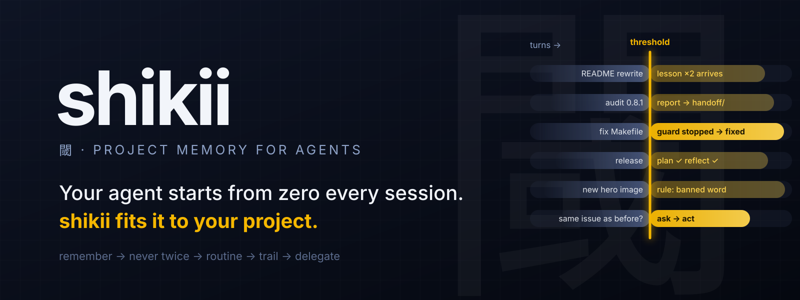
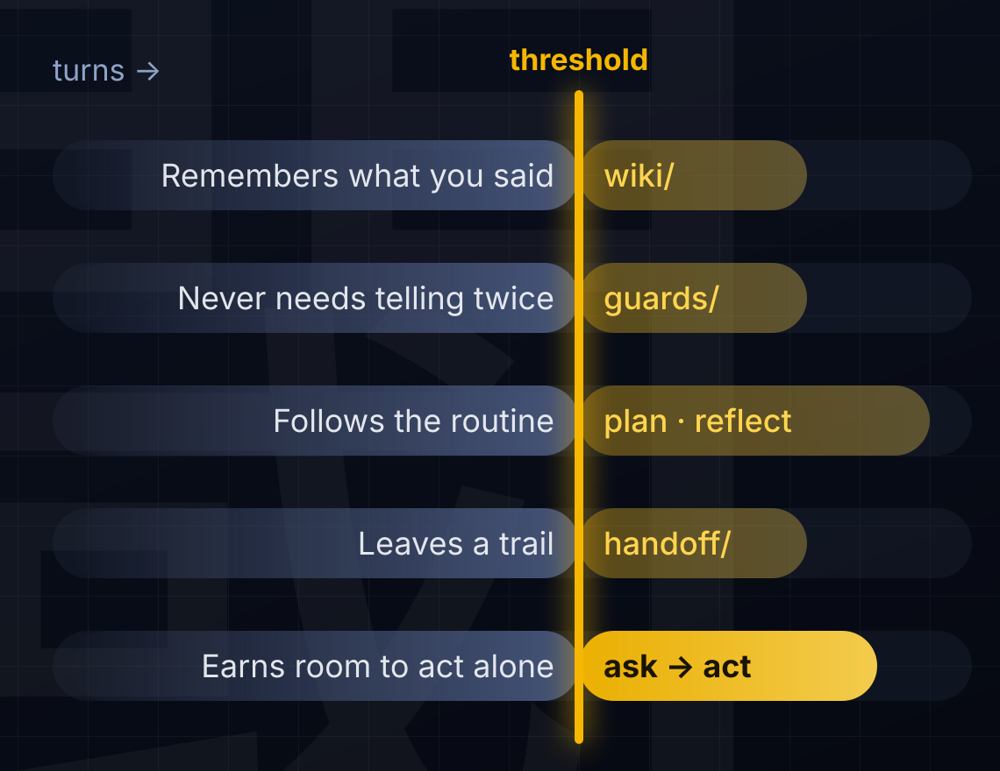
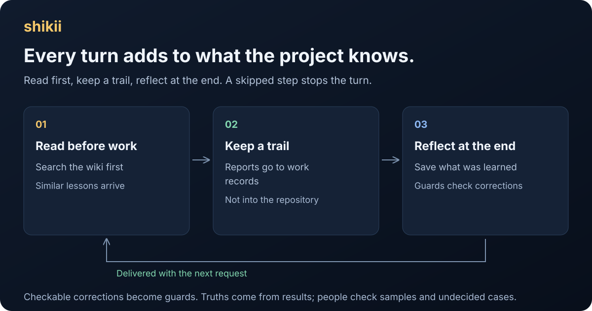
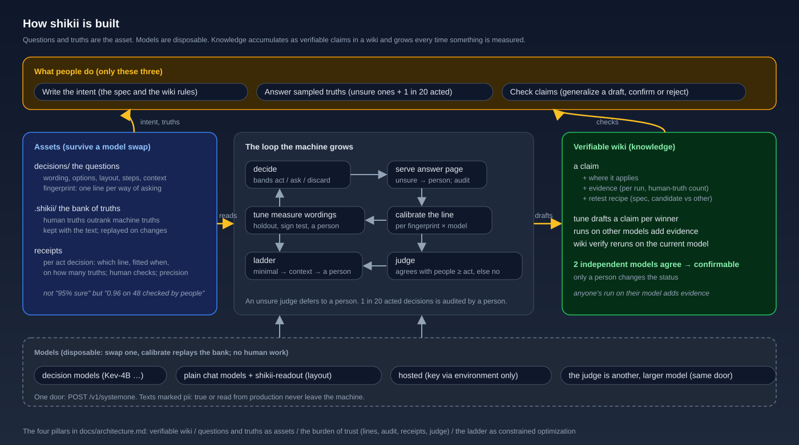

**English** · [日本語](docs/readme/README_ja.md)

<p align="center"></p>

# shikii: grow your agent to fit your project

Claude Code and Codex start every session from zero. They do not remember what you corrected, the steps you agreed on, or what was already checked. shikii keeps what was said, decided and checked in a project in `.shikii/`, and hands it to the agent before the next piece of work. What grows is the project, not the model, so nothing is lost when you change models.

**It remembers what you said, never needs telling twice, and earns room to act alone.**

[](go.mod)
[](.github/workflows/test.yml)
[](LICENSE)
[](docs/decision-ops-framework.md)
[](CHANGELOG.md)

Version 0.9.10 never leaves a part of a built-in file on a disk without hard links (exFAT) when init stops in the middle: the file is written in full first and then put in place. Version 0.9.9 kept more of your settings files as you wrote them: a JSON settings file with comments (`opencode.json`, read as JSONC the way OpenCode reads it) or with a key written twice is left alone, and init says what to add by hand and goes on instead of stopping. It also made shikii work on disks without hard links (exFAT), made uninstall remove the records of the pages it stops, and kept a folder move from stopping the page of another project that moved into the old path. Version 0.9.8 made `shikii init` say so when Codex already has shikii registered, instead of showing the block to add as if it might be missing. Version 0.9.7 let you move or rename the project folder with nothing to fix: the next request reconnects it by itself and says so once (a copy is not taken over). It also left your settings files as you wrote them: shikii writes into the file itself (links, permissions and the rest stay), refuses broken or unreadable settings instead of rewriting them, and only tells you about forms older versions wrote (Codex's server, a section in `AGENTS.md`). Version 0.9.6 made lessons from long-lived wiki pages (more than 16 sources) arrive again, fixed `shikii init` for people who already have their own MCP servers in Codex, and shortened the texts shikii adds to every request. Version 0.9.5 fixed the wiki after moving or renaming the project folder (sources captured before the move stay usable, so they no longer need capturing again) and the knowledge page that could stop with "the wiki cursor does not match" while an agent was working. Version 0.9.4 fixed the page after you answer: when the AI cannot tell the answers apart yet, it says so in plain words instead of reporting a failure; for the questions asked in the agent's turns it tries other wordings by itself, and for your own questions it says that rewording the question is what helps. Version 0.9.3 made Codex work across projects with one shared registration: the MCP server starts in any folder, and each tool call names the agent's working folder (`project`), so records land in the right project. Each request now becomes its own conversation, so reflection runs as it should; the agent decides in its pre-start organizing whether a message only continues the previous request, and outcome truths come from the person's words alone. Notices name questions by their titles on the page instead of internal ids. Since 0.9.2, shikii writes nothing into your AGENTS.md (the rules reach the agent through the hooks, the MCP instructions and the skill), and the agent can adopt better question wordings, which you can undo on the page. **Update every machine that uses the same wiki to 0.9.2 or later, and reopen your open agent sessions (and Codex) after the update.** **Updating from 0.6.0 or earlier erases the contents of `.shikii/` in every initialized project and initializes them again**; back up first. See the [changelog](CHANGELOG.md).

[The problem](#the-problem) · [What grows](#what-grows) · [What you do](#what-you-do) · [Requirements](#requirements) · [Get started](#get-started) · [How it works](#how-it-works) · [Delegate business decisions](#delegate-business-decisions) · [Memory belongs to a project](#memory-belongs-to-a-project) · [Read more](#read-more)

<p align="center"></p>

## The problem

Hand work to an agent and this tends to happen:

- You corrected it once and you are correcting the same thing in the next job.
- You wrote the lesson down, but you cannot tell whether the agent read it, or whether reading it changed anything.
- The subagents it spawns never see that lesson at all.
- It starts work without checking what was already decided, and forgets to write down what it learned.
- Its reports, notes and screenshots pile up in the repository, or are lost when the session ends.
- Nobody has measured how far you can trust its “probably, 0.9”.

If you repeat the same explanations and corrections every time, there was little point in handing the work over.

## What grows

Like someone who has worked on the project for a long time, the agent picks up five things.

<p align="center"></p>

| What grows | What shikii does |
|---|---|
| It remembers what you said | Corrections and decisions become lessons with sources and arrive before similar work |
| It never needs telling twice | Corrections a machine can check become guards that run at the end of every turn |
| It follows the routine | Before work it sums up the conversation and searches the wiki; before it ends it reflects. Skipping a step stops the turn |
| It leaves a trail | Reports, release logs, diffs and screenshots go to work records you read on the page |
| It earns room to act alone | As truths accumulate, a line is drawn above which the model is right often enough, and more decisions go ahead without asking |

1. **It remembers what you said.** From the requests, replies and corrections of ordinary conversations, the agent writes lessons with sources into the wiki. Each lesson carries a kind (a rule decided in this project, a how-to, criteria for a choice, a fact or assumption, or history) and a scene written in the words of that work ("when committing", "when sending an invoice"). Before a lesson is saved, the decision model finds the page it belongs to and checks it against earlier lessons. Up to two relevant lessons arrive before similar requests. A subagent receives lessons close to the task it was given. History lessons are read only when searched for. Rules, tests and procedures the agent makes or changes itself also go into the wiki right away, without being asked.
2. **It never needs telling twice.** Corrections a machine can check (“keep both changelogs in step”, “never use that word”, “write the original problem and the verification in the commit body”) become guards. When one fails, the agent cannot end the turn until it fixes the work.
3. **It follows the routine.** Before it changes files, the agent sums up what was agreed and what is still open, and searches the wiki with topic words it picks. Before it ends, it reflects on the turn, grades its own work and saves what it learned. If it skips either step, the turn is stopped once and the agent is told the exact command to run. These checks are built in and always on, also in projects without `CLAUDE.md` or `AGENTS.md`.
4. **It leaves a trail.** Audit reports, release steps, diffs and screenshots that the agent keeps editing go to `.shikii/handoff/<task>/`, and subagents are told to write their reports there too. They are not committed; you read them on the page under Knowledge → Work records.
5. **It earns room to act alone.** A model returns a probability, “probably 0.9”. From the truths people and results supply, shikii measures how the model's confidence relates to how often it is right, and draws a line above which it may act on its own. Until the line exists, nothing is automatic. Every decision falls into a band: `act` proceeds automatically, `ask` goes to a person, `discard` does nothing, `abstain` means an input or an endpoint is missing. When a line is drawn, or when there are enough truths but no line can be drawn (only one answer so far, or the answers cannot be separated), you are told once at the end of a turn. Truths live apart from the model, so changing models does not start you over. Alternative wordings can be scored on the same truths and the better one kept: the agent checks that it still asks the same thing and translates both into your language when it is not English, the new wording is switched in, and you are told with the translations and can undo it (when the agent cannot decide, you are asked).

The AI part of the page and `shikii status` show whether it is working: whether delivered lessons helped, how many turns did the routine, how many turns guards stopped and how many were fixed, how many decisions wait for a person, and which lines have been drawn.

## What you do

- **Correct your agent as usual.** “There is still English left” in an ordinary conversation is enough. The agent files it as a lesson and shikii keeps it next to the right page. When the correction can be checked by a machine, the agent also drafts a guard, disabled.
- **Enable guards.** Run `shikii guard enable <id>` once. shikii first shows the guard stopping on a deliberately broken example and passing on a correct one, then enables it. Disabling is also your call.
- **Answer some questions.** Under Answer on the page, the decisions the model was unsure about and 1 in 20 of the ones it acted on appear one card at a time. The count waiting is shown beside Answer. Read the conversation and press the button for what was actually true.
- **Look up knowledge when you need it.** At the top of the page's Knowledge section, every rule decided in this project, by people or by the AI, is listed so none gets buried; "always" rules come first and new ones are marked. Below it, pick a scene to see the lessons for it grouped by kind, and press a title to read it. You do not need to check everything: "For you to look at" at the top shows only the exceptions, such as a lesson that did harm or a correction that was repeated.
- **Read the work records when you want.** On the page, under Knowledge → Work records, you can read the agent's reports and see its screenshots.
- **Now and then confirm a wording.** When a better way of asking is found, you check that it asks the same thing and press adopt or reject.

Everything else is the machine's job.

## Requirements

| Use case | What you need |
|---|---|
| Learn from ordinary conversations and turn corrections into guards | Claude Code or Codex, shikii, and `shikii --init` in the projects you choose. Delivery to subagents is Claude Code only |
| Answer the built-in questions | Recommended: TypeSafe Jev with `TYPESAFE_API_KEY` in the environment, nothing to download. Without a key: llama.cpp (`llama-server`) and Ternary-Bonsai-27B through `shikii up`, about 7.6 GB to download and 10 GB of memory while running |
| Use another model for business decisions | Any System One endpoint from the table below |
| Install | macOS or Linux (amd64 or arm64), sh and curl. Go is not needed |
| Install from source | Go 1.27 or newer, Git and sh. The page is bundled; Node.js is not needed |
| Run the business API and page in containers | Docker with Compose, or Podman with a Compose provider ([setup](integrations/docker.md)) |
| Try the whole loop without a key or GPU | Go 1.27 or newer and the included fake model (`scripts/demo.sh`) |

| Endpoint | What it needs |
|---|---|
| Jev (TypeSafe AI) | Recommended. `TYPESAFE_API_KEY`. The built-in questions and every business decision whose `send_to` allows `hosted` go here when the key is set. [Official API](https://docs.typesafe.ai/introduction/quickstart) |
| llama.cpp | Without a key. Any chat GGUF through the included `shikii-readout` (the local standard is Ternary-Bonsai-27B; `shikii up` sets both up). Trained decision models such as OpenJev are passed through. Kev-4B is not supported. [Examples](integrations/readout.md) |
| Ollama / LM Studio | Their `/v1/systemone` endpoints with a decision model, for business decisions. Not tested in this release |

## Get started

### 1. Put a TypeSafe key in the environment (recommended)

Get an API key from [TypeSafe AI](https://docs.typesafe.ai/introduction/quickstart) and put it in the environment of your shell and your agent (`export TYPESAFE_API_KEY=…`). Nothing is downloaded and an ordinary PC is enough. With the key, the hooks and the built-in questions go to Jev and no local model is started (`shikii up` does not start one either). The request text, the agent's reply and wiki lessons are sent to TypeSafe for the built-in questions; they also stay in the local records. `SHIKII_MODEL=local` keeps a local model even with a key; `SHIKII_MODEL=hosted` forces Jev.

**Without a key: llama.cpp.** shikii then runs a local model. It is a 27B model that needs about 10 GB of memory while running, which can be heavy for an ordinary PC. On macOS with Homebrew:

```sh
brew install llama.cpp
llama-server --version
```

For other systems, see [llama.cpp's installation guide](https://github.com/ggml-org/llama.cpp/blob/master/docs/install.md). The default local model is **Ternary-Bonsai-27B Q2_g64** (`prism-ml/Ternary-Bonsai-27B-gguf`, Apache 2.0, about 7.6 GB to download and 10 GB of memory while running). `shikii up` starts llama-server on :8086 and `shikii-readout` on :8080, so hooks, MCP and the page always talk to :8080. Any other GGUF works the same way (`shikii up --gguf <file>`).

### 2. Install shikii

```sh
curl -fsSL https://raw.githubusercontent.com/hayaenfj/shikii/main/install.sh | sh
```

The installer downloads the latest release for your machine (macOS or Linux, amd64 or arm64) from GitHub Releases, checks it against the release's `SHA256SUMS`, and puts `shikii` and `shikii-readout` in `~/.local/bin`. It asks GitHub which release is the latest, so it gets a release as soon as it is published, and it does not need Go. It adds the binaries, the hooks (before a turn, after it, and when a subagent is launched and starts) and the agent's instructions, and says when the binary directory must be added to PATH. In Codex, trust the hooks with `/hooks`, and again whenever they change (after moving the binary or updating shikii); until then Codex skips them.

If the hooks stop working after you upgrade Go or move the binary, run `shikii doctor`: it says when the hooks or the Codex registration point to a shikii binary that no longer exists, and how to fix it.

**Building from source (for developers).** In a clone of this repository, `sh install.sh` builds the current source with Go 1.27 or newer and puts the binaries in the same `~/.local/bin`, then installs the hooks the same way (`make install` builds and copies the binaries only).

### 3. Initialize the projects you choose

In a project you want to enable, ask your agent:

> Use shikii in this project.

The agent runs `shikii --init` (you can run it yourself). Only initialized projects are enabled. The answer page is one per project: the first request's hook starts it on a free port and opens it in the browser (`shikii page` tells you the URL). Initialization prepares the built-in questions, the wiki, the place for guards, the folder for work records, the MCP setup (it adds `.mcp.json` and `opencode.json` to the project and does not write into `AGENTS.md` or `CLAUDE.md`; only `.shikii/` is excluded from Git; for Codex, which reads MCP servers only from the shared `~/.codex/config.toml`, it writes one shared registration without a project, and each tool call names the agent's working folder as `project`) and the agent's instructions. `shikii doctor` checks the setup.

### Updates

```sh
shikii update
```

This fetches the latest stable release, verifies its hashes and replaces shikii and readout. **Updating from 0.6.0 or earlier erases the contents of `.shikii/` in every initialized project and initializes them again.** Earlier conversations, lessons, truths and calibration are removed; back up anything you want to keep. Updates from 0.7.0 onwards keep them. Restart the page and MCP afterwards.

When updating from 0.8, also reopen your open agent sessions, and update every machine that uses the same wiki to 0.9.0 or later. shikii 0.8 cannot read articles that have a kind and scene, and refuses to save to the wiki (the articles are not damaged). In the same way, 0.9.1 and earlier read articles written by 0.9.2 (English fixed words in the article file) as changed, so update every machine that uses the same wiki to 0.9.2 or later.

When updating from 0.9.6, the update gives every project registered on this machine its store id once, so a project folder moved after the update is reconnected by itself (one moved before it is not: the hook says so, and `shikii --init` there keeps its wiki and records). Update every machine and reopen your agent sessions: when an older shikii registers a project again, the hook says so and asks to update every shikii.

When updating from 0.9.2 or earlier, the Codex registration an older shikii wrote is left as it is (since 0.9.7 shikii no longer rewrites it): init and the update show the block to write instead, with `args = ["mcp", "--local", "http://127.0.0.1:8080"]` (one registration for every project); reopen Codex after changing it. Until then, a block that names one project with `--store` makes every Codex session use that one project. A section an older shikii added to `AGENTS.md` is left too, and init and the update say which lines to remove.

### Uninstall

```sh
shikii uninstall        # lists what it would remove; changes nothing
shikii uninstall --yes  # removes it
```

This removes what shikii put into your agents: its hooks in `~/.claude/settings.json` and `~/.codex/hooks.json`, `[mcp_servers.shikii]` in `~/.codex/config.toml`, the shikii entry in each initialized project's `.mcp.json` and `opencode.json`, and the agent's instructions in `~/.claude/skills/shikii` and `~/.agents/skills/shikii`. It also stops the projects' answer pages. Your other hooks, MCP servers and settings, the files themselves, `AGENTS.md` and `CLAUDE.md` stay. The data stays too: each project's `.shikii/` and `~/.shikii/agent` are kept (only the records of the pages it stopped go), and installing again continues from them. The binaries are not removed; the last lines print the `rm` command with their paths. Reopen any open Claude Code and Codex sessions afterwards.

## How it works

With the hooks installed, two moments of every turn are kept: the request before the agent starts, and the reply and the changed files after it ends. The next human message closes the pair. A message that only continues the previous request ("ok", "continue", "sounds good") is attached to it instead; the agent decides this in its pre-start organizing, and a fixed list of acknowledgements is the fallback. The agent writes lessons with sources from them, and shikii delivers relevant lessons before similar work. In reflection the agent reports whether a delivered lesson helped.

<p align="center"></p>

Two steps of every turn are checked: planning before work and reflection before ending. When a step is missing, the end of the turn is stopped once with the command to run. The second stop passes, but the miss is recorded, and the page shows how many turns did the routine. After a short message that is not a plain acknowledgement, a turn without the organizing is also stopped once to ask only whether the message continues the previous request. A stopped turn is judged by the stop after it, or at the next request if that never comes.

The decision model answers the built-in questions about the agent's own work (what kind of request this is, whether to agree on an approach first, whether the changes stayed in scope, whether the request was completed) and, for new lessons, where they belong and whether they contradict a page. The truths for these come from what happens next: a change undone during the next request, a request repeated, a lesson merged or replaced. Only questions that results cannot answer wait for a person, and the page shows how many.

**Guards** are fixed rules, not the decision model. At the end of a turn they are applied to the changed files, the added lines and the commits of that turn. There are three kinds.

| Kind | Stops when | Example |
|---|---|---|
| `paired-files` | one file changed and its partner did not | `CHANGELOG.md` and `CHANGELOG_ja.md` |
| `forbidden-words` | an added line contains a word you decided not to use | words with an agreed replacement; excepted paths are not checked |
| `commit-body` | a commit made in the turn lacks a required word in its body | “original problem”, “after the change”, “verification” |

The agent drafts a guard from a correction (`shikii guard add`, disabled) and a person enables it (`shikii guard enable <id>`). Before enabling, shikii shows the guard stopping on a deliberately broken example and passing on a correct one. A turn that trips a guard cannot end until the work is fixed; the continuation after a stop is never stopped again, only recorded as fixed or not.

| Work | Usually done by | Your part |
|---|---|---|
| Lessons from conversations | Your usual agent | Correct it in ordinary conversation |
| Lesson placement, scope, completion | The decision model; truths from results | Check the samples and the undecided ones |
| Guards | Fixed rules; drafts by the agent | Decide whether to enable |
| The routine before and after work | The agent; checked by built-in rules | Nothing |
| Work records | The agent and its subagents | Read them on the page when you want |
| Business truths | You | Label; undo a wording the agent switched in if its meaning changed |

The design follows [Andrej Karpathy's LLM Wiki](https://gist.github.com/karpathy/442a6bf555914893e9891c11519de94f): raw sources are kept, and the agent ingests, searches and revises. Details: [the hooks](integrations/claude-code.md), [wiki editing](skills/shikii/references/wiki.md), [guards](skills/shikii/references/guards.md).

## Delegate business decisions

Decisions in your own work (“is this inquiry the same matter as the last one?”) can be handed over little by little in the same way. Write the question, the options, the inputs and the thresholds in a decision file (`shikii new`, or copy a [ready-made decision](decisions/README.md)) and keep supplying answers; once enough are in, a line can be drawn above which the model is right often enough to act alone. Until then, every decision goes to a person.

In a source checkout (the sample decision is not part of the installer):

```sh
shikii new same-issue --from decisions/same-issue.yaml              # copies the sample decision into .shikii/decisions/
SHIKII_MODEL=local shikii up                                     # this question is pii: true, so it needs the local model; with a key set, up only starts one under SHIKII_MODEL=local
shikii decide .shikii/decisions/same-issue.yaml -i report1="…" -i report2="…" --local http://127.0.0.1:8080
#   → band=ask   (no line yet: a person decides)
shikii serve --local http://127.0.0.1:8080                       # answer page: http://127.0.0.1:8095
#   Once a decision has the number of truths it asks for (eval.min_n), the line is drawn by itself.
shikii decide .shikii/decisions/same-issue.yaml -i report1="…" -i report2="…" --local http://127.0.0.1:8080
#   → band=act   with a record (how many truths, how many checked by a person, the precision of the act side)
```

| Band | What to do |
|---|---|
| `act` | Proceed automatically under the calibrated conditions |
| `ask` | Check with a person |
| `discard` | Do not act |
| `abstain` | Supply the missing input or an available endpoint |

Calibration belongs to one question and one model; change either and it is measured again. `shikii tune` scores alternative wordings on the stored truths; `shikii drift` and `shikii check` catch a model that drifted or a line that was weakened. To try this without a key or GPU, run `scripts/demo.sh` in the checkout.

- [Ready-made decisions](decisions/README.md) · [A business example](docs/examples/inquiry-route.md) · [Every command and the HTTP API](docs/guide.md) · [MCP](integrations/mcp.md) · [Measured numbers](docs/bench.md)

## Memory belongs to a project

Conversations, lessons, provisional assessments, truths, calibration, guards and work records live in that project's `.shikii/`. Unrelated projects stay apart. The shared `~/.shikii/agent` holds the templates, the tools and the list of projects. Because `.shikii/` contains private conversations, initialization keeps it out of Git's untracked files.

<p align="center"></p>

```text
.shikii/
  decisions/  questions for the decision model
  wiki/       lessons, conditions, earlier revisions
  guards/     checks made from your corrections
  records/    conversations, decisions, assessments, deliveries, observations, guard results
  labels/     truths from people and from results
  sessions/   per-session notes (lessons delivered, notices given, files changed)
  handoff/    work records: audit reports, release steps, diffs, screenshots (read on the page)
```

## Read more

- [The guide](docs/guide.md): every command, the HTTP API, connecting models, delegating business decisions
- [Architecture](docs/architecture.md)
- [The agent's instructions](skills/shikii/SKILL.md)
- [Changelog](CHANGELOG.md)

**For contributors**: tests are broken on purpose before they are fixed. Observations and truths are kept apart, and only measured numbers are written down. Fixed places and rules are preferred to more settings.

## License

[Apache-2.0 OR MIT](LICENSE). Choose [Apache 2.0](LICENSE-APACHE) or [MIT](LICENSE-MIT). Third-party dependencies, bundled code, models and external services keep their own licenses. Distributions must include the three license files and the third-party notices.
