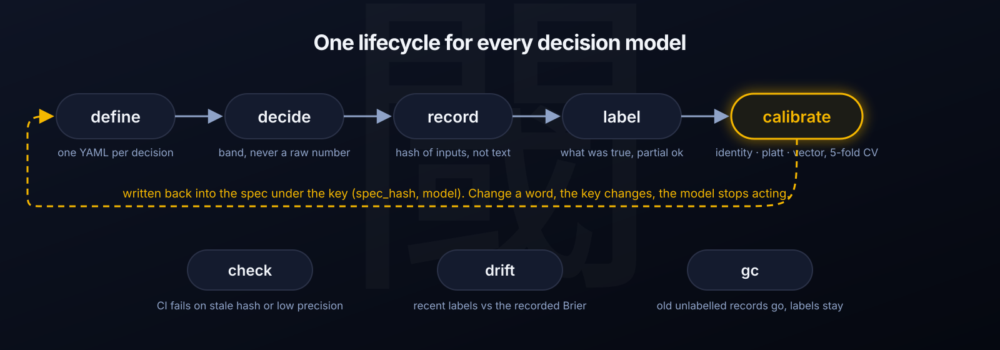

[English](../../README.md) · [日本語](README_ja.md) · [简体中文](README_zh.md) · [繁體中文](README_zh-TW.md) · [한국어](README_ko.md) · **Deutsch** · [Español](README_es.md) · [Français](README_fr.md) · [Italiano](README_it.md) · [Português (Brasil)](README_pt-BR.md) · [Русский](README_ru.md) · [Українська](README_uk.md) · [Polski](README_pl.md) · [Türkçe](README_tr.md) · [Tiếng Việt](README_vi.md) · [Bahasa Indonesia](README_id.md)

# shikii: Entscheidungsmodelle betreiben

### Ein Lebenszyklus für jedes Entscheidungsmodell: define → decide → record → label → calibrate → check → drift.

**Ein Modell liefert eine Wahrscheinlichkeit. shikii sagt Ihnen, ob Sie darauf handeln dürfen.**

[](../../go.mod)
[](../../.github/workflows/test.yml)
[](../../LICENSE)
[](../operations.md)

**[Designnotizen](../decision-ops-framework.md) · [Betrieb](../operations.md) · [Modellvergleich](../model-comparison.md) · [Ausführliche Anleitung (Japanisch)](../guide.ja.md)**

[Schnellstart](#schnellstart) · [So funktioniert shikii](#so-funktioniert-shikii) · [Was sich anbinden lässt](#was-sich-anbinden-lässt) · [Ergebnisse](#ergebnisse) · [FAQ](#faq) · [Dokumentation](#dokumentation)

<p align="center"></p>

`scripts/demo.sh`

> [!IMPORTANT]
> shikii führt nie ein Modell aus und liest nie einen Schlüsselbund. Es spricht mit einem Endpunkt für Entscheidungsmodelle, den Sie bereits haben, führt die Aufzeichnungen und weigert sich, zu **handeln** (`act`), solange die Wahrscheinlichkeiten für *genau diese Frage bei genau diesem Modell* nicht anhand von Labels verifiziert wurden. Kalibrierungsblöcke werden erzeugt, nie von Hand geschrieben.

---

Entscheidungsmodelle (TypeSafe Jev, Kev-4B und OpenJev auf llama.cpp, OpenRouter Decisions, …) beantworten typisierte Fragen, `choice`, `score` und `noul` (Ja/Nein), mit Wahrscheinlichkeiten und ohne generierten Text. Jeder Anbieter liefert denselben Hinweis mit: *Die Wahrscheinlichkeiten sind nicht auf Ihre Daten kalibriert, und Schwellenwerte lassen sich nicht auf andere Modelle oder Fragen übertragen.*

shikii kümmert sich um den Teil, den niemand mitliefert: den **Lebenszyklus** einer Entscheidung. Eine spec-Datei enthält die Frage, die Optionen, die Zustandsvorlage (`state`) und die Schwellenwerte. `decide` fragt ein Modell und gibt eine Stufe zurück (`act` / `ask` / `discard` / `abstain`), nie eine rohe Zahl. `label` hält fest, was tatsächlich zutraf. `calibrate` fittet und validiert per Kreuzvalidierung und schreibt das Ergebnis unter einem Schlüssel aus dem Hash der Frage und dem Modellnamen zurück in die spec. `check` lässt die CI scheitern, wenn Formulierung oder Modell abgedriftet sind. `gc` hält den store klein.

Dazu kommt `shikii-readout`, ein Adapter mit 500 Zeilen, der **jedes Chat-GGUF auf einem unveränderten llama.cpp** zu einem Entscheidungsmodell macht, indem er die Logits der Optionsbuchstaben liest. In unseren Messungen erreichte ein gewöhnliches ternäres 27B-Modell, auf diese Weise gelesen, dieselbe Genauigkeit wie trainierte Entscheidungsmodelle, bei 0,6 Sekunden pro Frage auf einem Laptop.

> Der Name ist japanisch: *shikii* (閾) bedeutet auf Japanisch „Schwellenwert“, die Linie, an der aus einer Wahrscheinlichkeit eine Handlung wird. Die CLI heißt `shikii`.

## Schnellstart

Go 1.27 oder neuer. Für den ersten Lauf wird sonst nichts benötigt.

### Den ganzen Kreislauf ohne Schlüssel und ohne GPU durchlaufen

```sh
git clone https://github.com/hayaenfj/shikii && cd shikii
scripts/demo.sh                 # Fake-Modell: decide → label → calibrate → check → drift → status → gc
scripts/demo.sh --overconfident # ein Fake-Modell, dessen Wahrscheinlichkeiten Kalibrierung brauchen; sehen Sie zu, wie calibrate platt wählt
```

### Auf ein echtes Modell richten

```sh
make build                                        # bin/shikii, bin/shikii-readout, bin/fake-systemone

# a) lokales Entscheidungsmodell auf llama.cpp (lädt beim ersten Start Kev-4B herunter, etwa 2,5 GB)
make server                                       # llama-server auf :8080
bin/shikii decide examples/prompt-intent.yaml --local http://127.0.0.1:8080 -i message='fix the typo in README'

# b) gehostetes TypeSafe Jev. Der Schlüssel kommt ausschließlich aus der Umgebung
export TYPESAFE_API_KEY=...
bin/shikii decide examples/prompt-intent.yaml -i message='fix the typo in README'

# c) OpenRouter Decisions API
export DECISIONS_API_KEY=...
bin/shikii decide examples/prompt-intent.yaml --hosted https://openrouter.ai/api/alpha/decisions -i message='…'
```

Die Antwort besteht aus einer Stufe, einer trace id und den Wahrscheinlichkeiten. Solange die spec keine Kalibrierung für dieses Modell enthält, ist die Stufe höchstens `ask`.

### Den Kreis schließen

```sh
bin/shikii label <trace_id> change_request          # oder:  label --last --spec-id prompt-intent change_request
bin/shikii calibrate examples/prompt-intent.yaml --model <Modellname aus der Antwort> --write
bin/shikii check examples/prompt-intent.yaml        # exit 1, wenn sich die Formulierung geändert hat oder precision@act unter act gefallen ist
```

### Ein beliebiges GGUF als Entscheidungsmodell nutzen

```sh
make server-gguf GGUF=/path/to/model.gguf ALIAS=my-model   # unveränderter llama-server mit Flash Attention und 8-Bit-KV, :8086
make readout                                               # shikii-readout davor, :8090
bin/shikii decide examples/prompt-intent.yaml --local http://127.0.0.1:8090 -i message='…'
```

### Installieren und aktualisieren

```sh
make install          # kopiert bin/shikii nach ~/.local/bin/shikii
git pull && make install
```

## So funktioniert shikii

Jede Entscheidung ist eine YAML-Datei: die Frage, die Optionen, die Zustandsvorlage, wohin der Zustand geschickt werden darf, die Schwellenwerte und, von `calibrate --write` erzeugt, die Kalibrierungsblöcke.

```yaml
id: prompt-intent
type: choice
question: What is the user asking the assistant to do?
options:
  - id: change_request
    description: Change something in the repository - edit, fix, add, remove, rename...
  - id: question
    description: Explain, investigate, compare or give an opinion, without changing anything.
state:
  template: "{{ message }}"
  required: [message]            # fehlende Eingabe → abstain; das Modell wird nie aufgerufen
policy:
  send_to: [hosted, local]       # eine tainted Sitzung überspringt hosted automatisch
  pii: possible                  # Aufzeichnungen speichern einen Hash der Eingaben, nie den Text
thresholds:
  act: 0.75                      # ≥ act → automatisch handeln, nur wenn kalibriert
  ask: 0.60                      # ≥ ask → einen Menschen fragen; darunter → discard
```

<p align="center"></p>

**Der Kalibrierungsschlüssel lautet `(Hash aus Frage + Vorlage + Optionen, vom Endpunkt zurückgegebene Modell-ID)`.** Ändern Sie ein Wort der Frage oder lassen Sie `jev-latest` auf eine neue Version rollen, und die Kalibrierung ist schlicht weg: Die Stufe fällt auf `ask`, statt stillschweigend mit veralteten Konstanten zu handeln. Auch das Prompt-Layout gehört zum Schlüssel: `shikii-readout` meldet sein Layout im Modellnamen (`…+state-last`), denn allein das Verschieben des Zustands im Prompt veränderte die Genauigkeit eines 27B-Modells bei gleichen Gewichten um 5 Punkte.

`calibrate` vergleicht drei Methoden per 5-facher Kreuzvalidierung und schreibt die beste. `identity` heißt, die rohen Wahrscheinlichkeiten erfüllen precision@act bereits, und das Modell wird lediglich als verifiziert markiert. `platt` (σ((Δ−bias)/T)) ist für Ja/Nein-Fragen. `vector` (softmax((log p + b)/T)) ist für choice und score und korrigiert Gewohnheiten einzelner Optionen, etwa „weicht im Zweifel auf *other* aus“. Partielle Labels (`!option`, „es war nicht *das*“) zählen für die precision, aber nicht fürs Fitten. Labels aus einer Datei werden persistiert, sodass `check` und `drift` danach offline laufen.

Für jeden sicherheitsrelevanten Zweig (Taint-Routing, kein act ohne Kalibrierung, Invalidierung bei veraltetem Hash, Label-Validierung, Erkennung von Inversionen, CV-basierte Methodenwahl, `gc` als Dry-Run, …) ist eine Mutation dokumentiert, die einen Test scheitern ließ, bevor der Fix akzeptiert wurde. Es gibt 63 Go-Tests in 8 Paketen; die Demo läuft in der CI.

## Was sich anbinden lässt

shikii spricht das System-One-Anfrageformat (`POST /v1/systemone`), also funktioniert alles, was es bereitstellt. Der Adapter deckt den Rest ab.

| Ziel | Was shikii bekommt | Voraussetzungen und Anleitung |
|---|---|---|
| **TypeSafe Jev** (gehostet) | `choice` / `score` / `noul` mit Wahrscheinlichkeiten, Modell-ID wie `jev-1.13.0` | `TYPESAFE_API_KEY` in der Umgebung. Standard bei `--hosted` |
| **Entscheidungsmodelle auf llama.cpp** (Kev-4B, OpenJev, Clef, …) | Dasselbe Format, lokal, Modell-ID aus `/v1/models` | `llama-server -hf ggml-org/Kev-4B-GGUF:Q4_K_M` (`make server`). llama.cpp 0.6.0 oder neuer |
| **OpenRouter Decisions API** | Dasselbe Format über OpenRouter | `DECISIONS_API_KEY`, `--hosted https://openrouter.ai/api/alpha/decisions` |
| **Jedes Chat-GGUF** über `shikii-readout` | Buchstaben-Logit-Auslesung im System-One-Format, ohne eigene Kalibrierung | Dahinter ein unveränderter `llama-server` 0.7.0. [`integrations/readout.md`](../../integrations/readout.md) |
| **PrismML Bonsai** über [BonJev](https://github.com/ChezRD/bonjev) | Dasselbe, mit BonJevs eigenem Prompt und eingebauter Kalibrierung | Rust-Build und der Prism-Fork. [`integrations/bonjev.md`](../../integrations/bonjev.md) |
| **Fake-Modell** (`bin/fake-systemone`) | Deterministische Wahrscheinlichkeiten für Demos und Tests | Nichts. `make fake` |
| **Claude-Code-Hook** (claude-jev) | Jeder Prompt wird klassifiziert, jeder Turn anhand des Arbeitsbaums gelabelt | [`integrations/claude-code.md`](../../integrations/claude-code.md) |

Taint ist eine erstklassige Eingabe: Übergeben Sie `--tainted` (oder lassen Sie Ihren Hook das tun) in einer Sitzung, die Produktionsdaten berührt hat, und die Anfrage verlässt den Rechner nie. Ist kein lokaler Endpunkt konfiguriert, enthält sich die Entscheidung (`abstain`).

## Ergebnisse

Gleiche specs, gleiche Labels, vier Auswertungssets (Prompt-Intention auf Englisch und Japanisch, 62 Anfragen; Fallzuordnung auf 32 japanischen Paaren). Details und die vollständige Tabelle stehen in [`docs/model-comparison.md`](../model-comparison.md).

| Modell | Lizenz | top-1 (gesamt / Japanisch) | Ja/Nein-Brier (roh) | Gewählte Kalibrierung | Sekunden pro Frage |
|---|---|---|---|---|---|
| Kev-4B (trainiertes Entscheidungsmodell) | Apache 2.0 | 0.919 / 0.913 | 0.046 | identity | 0.25 |
| OpenJev 27B (trainiert) | CC BY-NC 4.0 | **0.984 / 1.000** | 0.020 | vector | 3.8 |
| Bonsai 2 27B über BonJev | Apache 2.0 | 0.968 / 1.000 | 0.026 → **0.013 (platt)** | vector / platt | 2.5 |
| **Ternary-Bonsai-27B über `shikii-readout`, unverändertes llama.cpp** | Apache 2.0 | 0.968 / 1.000 | 0.015 | identity | **0.58** |

**Formulierung schlägt Kalibrierung.** Bei der Prompt-Intention landeten 19 von 21 Fehlern bei *other*; allein durch Umformulieren der Optionen stieg top-1 von 0,68 auf 0,90, noch vor jeder Kalibrierung. Kalibrierung hilft bei „Reihenfolge stimmt, Konfidenz reicht nicht“. Die Konfusionsmatrix, die `calibrate` ausgibt, zeigt, welcher Fall vorliegt.

**Bereits kalibrierte Modelle brauchen kein Platt.** Das Ja/Nein von Kev-4B hatte roh einen Brier von 0,046; Platt machte es in der Kreuzvalidierung schlechter, also wurde `identity` geschrieben. Zum ersten Mal wählte `calibrate` `platt` bei einem gewöhnlichen LLM, das über Logits gelesen wurde. Ob Kalibrierung nötig ist, ist eine Eigenschaft von *Modell plus Auslesung*, nicht des Modells allein.

**Ein gewöhnliches GGUF landet neben einem trainierten Entscheidungsmodell.** Ein ternäres 27B-Chatmodell, Mainline-llama.cpp 0.7.0, ein Adapter, kein Fork, kein Training, kein Rust: dasselbe top-1 wie das beste trainierte Modell unter Apache-Lizenz, Japanisch 1.000, 0,58 s pro Frage mit Flash Attention und aufgewärmtem Präfix. Den Zustand von vor den Optionen direkt vor die Antwort zu verschieben, hob bei gleichen Gewichten von 0.919 auf 0.968; deshalb ist das Layout Teil des Kalibrierungsschlüssels.

## FAQ

**Führt shikii Modelle aus?** Nein. Es schickt System-One-Anfragen an einen Endpunkt, den Sie betreiben oder mieten, und verwaltet alles, was nach der Antwort passiert. `shikii-readout` ist dem Geist nach die eine Ausnahme: Es wandelt die Logits eines Chatmodells in dasselbe Format um, aber die Inferenz bleibt die von llama.cpp.

**Warum erreicht meine Entscheidung nie `act`?** Weil die spec keinen Kalibrierungsblock für `(dieser Frage-Hash, diese Modell-ID)` hat. Sammeln Sie Labels (`label` oder `--labeled file`), führen Sie `calibrate --write` aus, und `status` zeigt `calibrated: identity|platt|vector`. Eine Entscheidung ohne verifizierte precision am act-Schwellenwert darf nicht handeln. Das ist der Sinn der Sache.

**Ich habe ein Wort in der Frage geändert, und die Kalibrierung ist verschwunden.** Richtig. Der Hash hat sich geändert, die Konstanten waren auf eine andere Frage gefittet. `status` zeigt die alten Labels als `stale hash`; führen Sie `calibrate --write` erneut aus, sobald Sie Labels für die neue Formulierung haben.

**Welches Modell soll ich nehmen?** Das hängt von Lizenz, Geschwindigkeit und Sprache ab, und shikii entscheidet das nicht für Sie. Die Tabelle oben und [`docs/model-comparison.md`](../model-comparison.md) sind das Argument: Mit derselben spec und denselben Labels können Sie nach Zahlen wählen, auch danach, ob ein Modell überhaupt Kalibrierung braucht. `scripts/eval-model.sh <url> <name>` reproduziert die Tabelle für einen neuen Endpunkt.

**Funktioniert es auf Japanisch?** Ja, und genau dort zeigen sich die Unterschiede. Kev-4B erreicht bei japanischen Prompts 0.913, die 27B-Modelle 1.000. Die Fallzuordnung bei japanischen Ermittlungszusammenfassungen trennt bei jedem 27B-Modell Positive und Negative vollständig.

**Wohin gehen meine Daten?** Nur der gerenderte Zustand geht an den in `send_to` genannten Endpunkt. Mit `pii: possible` (Standard) speichert der store einen Hash der Eingaben, nie den Text. `--tainted` hält alles lokal. Schlüssel werden aus `DECISIONS_API_KEY` oder `TYPESAFE_API_KEY` gelesen und sonst nirgends.

**Der store wächst immer weiter.** `shikii gc` entfernt Aufzeichnungen, die älter als 30 Tage sind und nie ein Label bekommen haben. Gelabelte Aufzeichnungen und Labels bleiben für immer, da sie das Kalibrierungsmaterial sind. Ohne `--apply` ist es ein Dry-Run.

**Bevorzugt es die erste Option?** Erst messen, dann korrigieren: `shikii bias <spec> --permutations 100` mischt die Optionen und meldet Umkehrungen und die Positionsverschiebung. Kev-4B: 0 Umkehrungen in 100, Verschiebung ≤ 0.024. Gewöhnliche LLMs, die über Logits gelesen werden, können abweichen; der Befehl ist für sie da.

## Dokumentation

- [`docs/decision-ops-framework.md`](../decision-ops-framework.md): Designnotizen, was das Framework übernimmt und was es bewusst nicht übernimmt, der Verifikationsplan und was bestätigt wurde.
- [`docs/operations.md`](../operations.md): wie sich jedes bewegliche Teil stoppen oder zurückrollen lässt, wie man einen Fehler liest, was noch fehlt.
- [`docs/model-comparison.md`](../model-comparison.md): die Vergleichstabelle und wie man sie reproduziert.
- [`docs/guide.ja.md`](../guide.ja.md): die ausführliche japanische Anleitung mit allen Befehlen und einem vollständigen Durchlauf aus der Praxis.
- [`integrations/readout.md`](../../integrations/readout.md), [`integrations/bonjev.md`](../../integrations/bonjev.md), [`integrations/claude-code.md`](../../integrations/claude-code.md): die drei Anbindungen, die wir betreiben.
- [`examples/`](../../examples/) und [`testdata/`](../../testdata/README.md): eine spec ohne Kalibrierung als Ausgangspunkt und die synthetischen gelabelten Datensätze aus den Tests.

Die Befehle:

```
shikii decide    <spec> -i k=v ... [--hosted URL] [--local URL] [--tainted] [--store DIR] [--json]
shikii label     <trace_id> <truth> | --last --spec-id ID <truth>   [--weight W] [--source ask|outcome|manual]
shikii calibrate <spec> [--labeled file] [--model M] [--store DIR] [--write] [--force]
shikii check     <spec>...  [--store DIR]                 # CI: stale hash, handgeschriebene Blöcke, precision@act unter act → exit 1
shikii drift     <spec> --model M [--window N]            # aktuelle Labels gegen Brier und precision aus der Kalibrierung
shikii bias      <spec> [--rows K] [--permutations N]     # hängt die Antwort von der Reihenfolge der Optionen ab?
shikii status    [spec...] [--store DIR]                  # Bestandsaufnahme: Aufzeichnungen, Labels, Quellen, Zustand pro (Modell, Hash)
shikii gc        [spec...] [--older-than 30d] [--apply]   # alte ungelabelte Aufzeichnungen löschen; standardmäßig Dry-Run
shikii hash      <spec>
```

## Mitwirken

Issues und Pull Requests sind willkommen. Eine Regel: Ein Test, der ein Verhalten absichert, muss zuerst scheitern. Brechen Sie das Verhalten absichtlich, lassen Sie den Test laufen, halten Sie fest, wie er gescheitert ist, beheben Sie es und halten Sie fest, dass er besteht. Die Dokumentation listet diese Mutationen für jeden Sicherheitszweig auf; halten Sie die Liste ehrlich.

## Lizenz

[Apache 2.0](../../LICENSE). Die Modelllizenzen sind davon getrennt: Kev-4B und die Bonsai-Familie stehen unter Apache 2.0, OpenJev unter CC BY-NC 4.0, das gehostete Jev ist der Dienst von TypeSafe. shikii speichert Ihre Wahrscheinlichkeiten und Labels, nichts von den Modellen.
