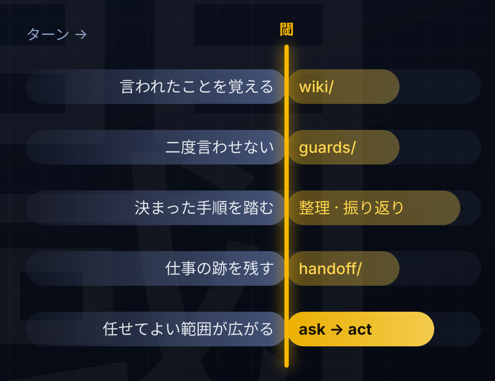
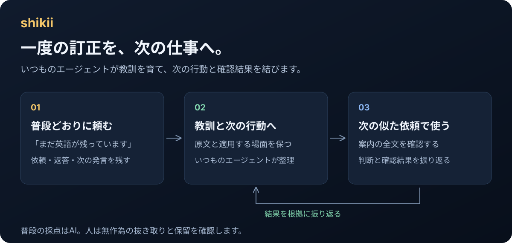
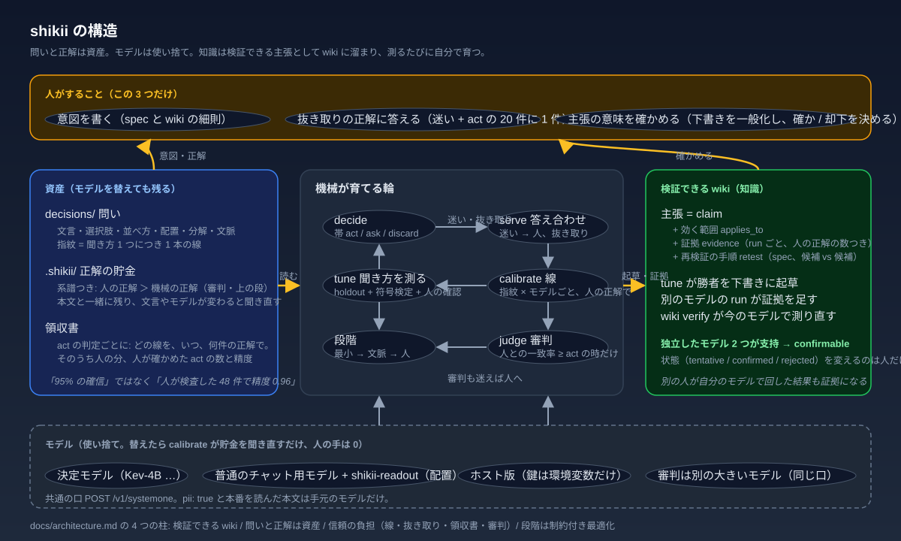

[English](../../README.md) · **日本語**

<p align="center"></p>

# shikii: エージェントを、あなたのプロジェクトに合わせて育てる

AIエージェントは、メモリーで以前の仕事を引き継げます。プロジェクトでは、その経験を必要な時に使い、役立ったかを確かめ、判断をどこまで任せるかも測っていきたい。shikiiは、この流れをつなぎます。言われたこと・決めたこと・確かめたことを `.shikii/` に貯め、関係する知識を届け、結果を次の仕事へ戻します。育つのはモデルではなくプロジェクトの側なので、モデルを替えても知識は残ります。

**言ったことを覚え、二度言わせず、任せられる範囲が広がる。**

[](../../go.mod)
[](../../.github/workflows/test.yml)
[](../../LICENSE)
[](../decision-ops-framework.ja.md)
[](../../CHANGELOG_ja.md)

0.29.0では、調査手順の候補生成・別課題での検証・採用・悪化時の復帰を、通常の作業記録へつなぎます。prepareで開始を記録し、終了報告で変更・証拠・残件を一度送ります。応答量に上限を設け、整理待ちは保存済みの原資料から回復します。エージェント内部の技術的な評価を、人の回答待ちから外します。[変更履歴](../../CHANGELOG_ja.md)と[記録の手順](../../skills/shikii/references/recording.md)をご覧ください。

同じプロジェクトへ書く本体を全て更新し、hookなしの場合は既存のプロジェクトで `shikii --init` を実行して作法も更新してください。その後、エージェントのセッション・ページ・MCPを起動し直します。既存の記録を保持し、原資料を残したメモリ更新作業をエージェントへ届けます。進捗は英語で表示します。詳しくは[記憶と学習](../memory-and-learning.ja.md)を参照してください。

[困りごと](#困りごと) · [何が育つか](#何が育つか) · [人がすること](#人がすること) · [必要なもの](#必要なもの) · [始め方](#始め方) · [仕組み](#仕組み) · [業務の判定を任せる](#業務の判定を任せる) · [記憶はプロジェクトのもの](#記憶はプロジェクトのもの) · [もっと読む](#もっと読む)

<p align="center"></p>

## 困りごと

エージェントに仕事を頼むと、こうなりがちです。

- 一度直してもらったことを、次の仕事でまた直している
- 教訓を書き残しても、エージェントが読んだのか、読んで行動が変わったのかが分からない
- サブエージェントに任せた仕事には、その教訓がそもそも届かない
- 決まっていることを確かめずに作業を始め、学んだことを書き残し忘れる
- 報告・メモ・画像がrepoに散らばるか、セッションが終わると消える
- AIの「たぶん、0.9」をどこまで信じて任せてよいのか、誰も測っていない

人が毎回同じ説明と訂正を繰り返すなら、AIに任せた意味がほとんどありません。

## 何が育つか

そのプロジェクトで長く働いた人のように、エージェントが次の5つを身につけます。

<p align="center"></p>

| 育つもの | shikiiがすること |
|---|---|
| 言われたことを覚えている | 訂正や決めたことが出典付きの教訓になり、似た仕事の前に届く |
| 同じことを二度言わせない | 機械で確かめられる訂正は、ターンの終わりに確かめ、コマンドは流す直前に断る「止める検査」になる |
| 決まった手順を踏む | 作業の前に会話を整理してwikiを探し、終える前に振り返る。飛ばすと止まる |
| 仕事の跡を残す | 報告・リリースの記録・差分・画像を作業記録に残し、画面で読める |
| 任せてよい範囲が広がる | 正解が貯まるほど「ここより上なら当たる」線が引け、人に聞かずに進める判断が増える |

1. **言われたことを覚えます。** 普段の会話の依頼・返答・訂正から、エージェントが出典付きの教訓をwikiに書きます。教訓には種類(このプロジェクトで決められたルール・やり方・判断の基準・前提と事実・経緯)と、その仕事の言葉で書いた場面(「コミットする時」「請求書を出す時」など)が付きます。保存の前に、決定モデルが差し込み先の記事を探し、前の教訓と食い違わないかを見ます。似た依頼の前には関係する教訓が最大2件届きます。サブエージェントには、頼まれた仕事の文に近い教訓が届きます。経緯の教訓は、探した時にだけ読みます。エージェントが自分で作った・変えた決まりやテストや手順も、頼まれなくてもその場でwikiに書きます。
2. **同じことを二度言わせません。** 「変更履歴は英語と日本語を揃える」「この語は使わない」「コミット本文に元の問題と検証を書く」のように機械で確かめられる訂正は、止める検査になります。引っかかるとエージェントは終われず、直してから終えます。
3. **決まった手順を踏みます。** ファイルを変える前に、エージェントは合意したことと未決のことを整理し、自分で選んだ話題の語でwikiを探します。終える前にそのターンを振り返り、自分の仕事を採点し、学んだことを保存します。どちらかを飛ばすと、打つべきコマンドをエージェントへ伝えます。保存結果を確認してから完了を判定し、残件が減れば続きを促します。減らなければ未完了と表示して自動継続を止めます。この確かめは組み込みでいつも効き、`CLAUDE.md` や `AGENTS.md` の無いプロジェクトでも効きます。
4. **仕事の跡を残します。** 書き換えながら進める監査の報告・リリースの手順・差分・画像は `.shikii/handoff/<仕事>/` に入り、サブエージェントにも報告をここへ書くよう伝えます。repoにはコミットされず、人は画面の「知識 → 作業記録」で読みます。
5. **任せてよい範囲が広がります。** モデルは「たぶん0.9」と確率を返します。shikiiは人と結果が付けた正解から、モデルの自信と当たる割合の関係を測り、「ここより上なら自動で進めてよい」という線を引きます。線が引けるまでは自動では動きません。判断はすべて帯に分かれます。`act` は自動で進める、`ask` は人に確かめる、`discard` は動かない、`abstain` は入力か接続先が足りない、です。線が引けた時と、正解が足りても線を引けない時(答えが片方だけ、答えを分けられない、またはそのために問いを止めた)は、ターンの終わりに一度だけ知らせます。正解はモデルと別に残るので、モデルを替えても最初からやり直しません。別の聞き方を同じ正解で採点し、良い方を残すこともできます。意味が同じかはエージェントが確かめ(英語以外の設定ならその言語に両方を訳し)、同じならその聞き方に変えて知らせます(違っていたら元に戻せます。エージェントが決めきれない時だけ人に聞きます)。

効いているかは、画面の「AI の様子」と `shikii status` で見ます。届けた教訓が役立ったか、手順を踏んだターンの数、止める検査が止めて直った数、人を待つ判定の数、引けた線が出ます。

## 人がすること

- **普段どおりエージェントを訂正する。** 会話の中で「まだ英語が残っている」と言えば十分です。エージェントが教訓にし、shikiiが正しい記事の隣に置きます。機械で確かめられる訂正なら、エージェントが止める検査の草稿（無効）も置きます。
- **止める検査を有効にする。** `shikii guard enable <id>` を一度打ちます。shikiiは、その検査がわざと壊した例で実際に止まり、正しい例で通ることを見せてから有効にします。外すのも人の判断です。
- **いくつかの答えを付ける。** 画面の「答える」に、モデルが迷った判断と、自動で進めた判断の20件に1件が、1枚ずつ出ます。待っている数は「答える」の横に出ます。会話を読んで、本当はどうだったかのボタンを押します。
- **知りたい時に知識を引く。** 画面の「知識」の一番上には、人やAIが決めた「このプロジェクトで決められたルール」が全部並び、埋もれません。「いつも」のルールが先頭で、新しいルールには「新」のラベルが付きます。その下で場面を選ぶと、その場面に効く教訓が種類ごとに並び、題を押すと本文が出ます。全部を確かめる必要はありません。上の「あなたに見てほしいもの」に、害があった教訓や繰り返された訂正のような例外だけが出ます。
- **知識を編集・削除する。** 記事を開いて「編集」「削除」を選べます。削除すると検索や配信から外れ、出典と履歴は残ります。
- **読みたい時に作業記録を読む。** 画面の「知識 → 作業記録」で、エージェントの報告を読み、画像を見られます。
- **たまに聞き方を確かめる。** より良い聞き方が見つかったら、同じことを聞いているかを見て、採用か却下を押します。

それ以外は機械の仕事です。

## 必要なもの

| やりたいこと | 必要なもの |
|---|---|
| 普段の会話から学び、訂正を検査にする | Claude CodeまたはCodex、shikii、利用するプロジェクトでの `shikii --init`。サブエージェントへの配送はClaude Codeだけ |
| 既製の問いに答えさせる | 推奨: TypeSafeのJev（環境変数 `TYPESAFE_API_KEY`。取得するものは無い）。鍵を置けない時: llama.cpp（`llama-server`）とTernary-Bonsai-27Bを `shikii up` で立てる構成（取得 約7.6GB、動作中のメモリ約10GB） |
| 業務の判定に別のモデルを使う | 下の表のSystem One形式の接続先 |
| インストールする | macOSかLinux（amd64かarm64）、sh、curl、tar、awk、shasumかsha256sum（どちらのOSにも初めからある）。Goは不要 |
| ソースからインストールする | Go 1.27以上、Git、sh。画面は同梱済みでNode.jsは不要 |
| コンテナで業務のAPIと画面を動かす | DockerとCompose、またはPodmanとCompose provider（[準備](../../integrations/docker.ja.md)） |
| 鍵やGPUなしで一周試す | Go 1.27以上と同梱の偽モデル（`scripts/demo.sh`） |

| 接続先 | 準備するもの |
|---|---|
| Jev（TypeSafe AI） | 推奨。`TYPESAFE_API_KEY`。鍵があれば、既製の問いと、`send_to` に `hosted` を含む業務の判定がここへ送られる。[公式仕様](https://docs.typesafe.ai/introduction/quickstart) |
| llama.cpp | 鍵を置けない時。通常のチャットGGUFを同梱の `shikii-readout` 越しに（手元の標準はTernary-Bonsai-27B。`shikii up` が両方を立てる）。OpenJevのような学習済みの決定モデルはそのまま通す。Kev-4Bは使えない。[実行例](../../integrations/readout.ja.md) |
| Ollama / LM Studio | `/v1/systemone` と決定モデル。業務の判定向け。この版では未検証 |

## 始め方

### 1. TypeSafeの鍵を置く（推奨）

[TypeSafe AI](https://docs.typesafe.ai/introduction/quickstart)でAPIの鍵を取得し、シェルとエージェントの環境変数に置きます（`export TYPESAFE_API_KEY=…`）。取得するものはなく、普通のPCで動きます。鍵があれば、hookも既製の問いもJevへ送り、手元のモデルは起こしません（`shikii up` も起こしません）。既製の問いのために、依頼文・エージェントの返答・wikiの教訓がTypeSafeへ送られます（手元の記録にも残ります）。鍵を置いたまま手元のモデルを使うなら `SHIKII_MODEL=local`、Jevに固定するなら `SHIKII_MODEL=hosted` を置きます。

**鍵を置けない時はllama.cppです。** 鍵が無ければ手元のモデルを動かします。27Bのモデルなので動作中のメモリが約10GB要り、普通のPCでは重いことがあります。macOSでHomebrewなら:

```sh
brew install llama.cpp
llama-server --version
```

macOS以外は[llama.cppの公式の手順](https://github.com/ggml-org/llama.cpp/blob/master/docs/install.md)を参照してください。手元の基本モデルは **Ternary-Bonsai-27B Q2_g64**（`prism-ml/Ternary-Bonsai-27B-gguf`、Apache 2.0。取得は約7.6GB、動作中のメモリは約10GB）です。`shikii up` がllama-serverを `:8086` に、`shikii-readout` を `:8080` に立てるので、hook・MCP・画面は常に `:8080` を見ます。他のGGUFも同じ形で使えます（`shikii up --gguf <file>`）。

### 2. shikiiをインストールする

```sh
curl -fsSL https://raw.githubusercontent.com/hayaenfj/shikii/main/install.sh | sh
```

インストーラーは、GitHub Releasesからこの機械向け（macOSかLinux、amd64かarm64）の最新版を取ってきて、版の `SHA256SUMS` と照らしてから、`shikii` と `shikii-readout` を `~/.local/bin` に置きます。どれが最新版かをGitHubに聞くので、出したばかりの版もすぐ入り、Goは要りません。実行ファイル、hook（依頼の前・作業の後・サブエージェントを起こす時と始まる時）、エージェントの作法を入れ、PATHに足す必要があれば案内します。Codexでは `/hooks` でhookを信頼してください。hookの中身が変わるたび(実行ファイルを動かした時やshikiiを更新した時)にもう一度信頼が要り、それまでCodexはhookを飛ばします。

Goを上げた後や実行ファイルを動かした後にhookが働かなくなったら、上の1行をもう一度流してください。多くは実行ファイルそのものが消えていて(miseのようなGoの版の管理ツールでは、Goを上げると `go install` が置いた版ごとのフォルダごと消えます)、`shikii doctor` も一緒に消えています。`shikii` がまだ動く時は `shikii doctor` を流すと、hookやCodexの登録が、もう無い・動かせないshikiiの実行ファイルを指している時はそう言い、直し方を出します。

**前に `go install` で入れた人へ。** その実行ファイルはGoのフォルダ(`$(go env GOPATH)/bin` か `GOBIN`)に残り、`shikii update` もそこで更新するだけで、`~/.local/bin` へは移しません。上の1行を一度流すと、hookは `~/.local/bin/shikii` を動かすようになります。先に `~/.local/bin` がPATHにあることを確かめてください(無ければインストーラーがそう言います)。Claude CodeとOpenCodeのMCPは `shikii` を名前で動かします。そのあとGoのフォルダの古い `shikii` と `shikii-readout` を手で消し、もう一度 `shikii hook install --yes` を流してください。それまでは実行ファイルが2つあり、端末で打つ `shikii` と、Claude CodeとOpenCodeのMCP(`shikii` を名前で動かす)は、PATHで先に見つかる方を動かし(`command -v shikii` でどちらかわかります)、`shikii update` はその1つだけを更新し、CodexのMCPの登録は古い実行ファイルが残る間はそちらを指したままです。

**ソースから組む（開発する人向け）。** このリポジトリをcloneした中で `sh install.sh` を流すと、今のソースをGo 1.27以上で組んで同じ `~/.local/bin` に置き、hookも同じように入れます（`make install` は組んで実行ファイルを写すだけです）。

### 3. 利用するプロジェクトを初期化する

使いたいプロジェクトで、エージェントにこう頼みます。

> このプロジェクトでshikiiを使って

エージェントが `shikii --init` を実行します（自分で実行しても同じ）。初期化したプロジェクトだけで動きます。答え合わせの画面はプロジェクトごとに 1 つで、最初の依頼の hook が空いているポートで起こしてブラウザで開きます（URL は `shikii page`）。既製の問い・wiki・止める検査の置き場・作業記録の置き場・MCPの設定（プロジェクトに `.mcp.json`・`opencode.json` が足されます。`AGENTS.md` と `CLAUDE.md` には書きません。Gitの除外に入るのは `.shikii/` だけです。MCPを共通の `~/.codex/config.toml` からしか読まないCodexには、プロジェクトを書かない共通の登録を1つ書き、道具を呼ぶたびにエージェントの作業フォルダを `project` で渡します）・エージェントの作法が用意されます。`shikii doctor` で状態を確かめます。

### 更新

```sh
shikii update
```

最新の安定版を取得し、ハッシュを確かめ、shikiiとreadoutを置き換えます。**0.6.0以前からの更新は、初期化済みの各プロジェクトの `.shikii/` の中を全部消して初期化し直します。** 以前の会話・教訓・正解・較正は消えます。残したいものは先に控えてください。0.7.0以降からの更新では残ります。更新後は画面とMCPを再起動してください。

0.8系からの更新では、開いているエージェントのセッションも開き直し、同じwikiを使う機械を全部0.9.0以上にします。0.8系のshikiiは種類と場面を付けた記事を読めず、wikiへの保存を断ります(記事は壊れません)。同じように、0.9.1以前は0.9.2が書いた記事(記事のファイルの決まった語が英語)を「変更あり」と見なすので、同じwikiを使う機械は全部0.9.2以上にします。

0.28.0へ更新した後は、同じwiki・進行中のセッション・担当割り当ての記録を書く全プロセスを更新し、セッション・画面・MCPを再起動してください。旧版は新しい読取計測・品質報告の進捗を保持できません。hookなしの場合は既存の初期化済みプロジェクトで`shikii --init`を再実行すると、データを保持しhookを有効にせずskillを更新できます。0.27.0からの更新ではデータと既存の記事・実行結果を保持します。条件に合う結果の選択には0.25.0以降が必要です。chitenから実利用・実行結果を返す場合は、対応するchitenも別途必要です。0.24より前の書き手は担当のcontextやイベントとreceiptの対応を保持できず、0.22より前の本体では学び付きの記事を読めません。旧版へ戻す必要がある場合は、更新前の`.shikii/`を控え、本体とデータを一緒に戻せるようにしてください。

0.9.6からの更新では、この機械に登録された全プロジェクトに、置き場のidを1回だけ書きます。更新の後に移したプロジェクトのフォルダは、自分でつなぎ直ります(更新の前に移した物はつなぎ直りません。hookがそう知らせ、そこで `shikii --init` すればwikiと記録はそのまま使えます)。機械を全部上げ、エージェントのセッションを開き直してください。古いshikiiがプロジェクトをもう一度登録すると、hookがそう知らせ、全部のshikiiを上げるよう頼みます。

0.9.2以前からの更新では、古いshikiiが書いたCodexの登録をそのまま残します(0.9.7から書き直しません)。initと更新が、代わりに書く節を出します。`args = ["mcp", "--local", "http://127.0.0.1:8080"]`(全部のプロジェクトで1つの登録)の形です。直した後はCodexを開き直してください。直すまでは、`--store` で1つのプロジェクトを指す節のままなら、どのCodexのセッションもその1つのプロジェクトを使います。古いshikiiが `AGENTS.md` に足した節も残し、initと更新が手で消す範囲を知らせます。

### アンインストール

```sh
shikii uninstall        # 外す物の一覧を出すだけで、何も変えない
shikii uninstall --yes  # 外す
```

shikiiがエージェントに入れた物を外します。`~/.claude/settings.json` と `~/.codex/hooks.json` のshikiiのhook、`~/.codex/config.toml` の `[mcp_servers.shikii]`、初期化した各プロジェクトの `.mcp.json` と `opencode.json` のshikiiの項目、`~/.claude/skills/shikii` と `~/.agents/skills/shikii` のエージェントの作法です。プロジェクトの答え合わせの画面も止めます。ほかのhook・MCP・設定、ファイルそのもの、`AGENTS.md` と `CLAUDE.md` は残ります。データも残ります。各プロジェクトの `.shikii/` と `~/.shikii/agent` は消さず(止めた画面の記録だけは消します)、もう一度インストールすればその続きから使えます。実行ファイルは消しません。最後に、そのパスを入れた `rm` のコマンドを出します。外した後は、開いているClaude CodeとCodexのセッションを開き直してください。

## 仕組み

0.24で追加した任意の担当連携APIを使い、0.25ではchitenの報告から知識の実利用と手順結果を記録します。記事を読んだこと、判断に使ったこと、手順を実行したことを分け、出典・読んだ版・当時の条件を保ちます。実利用と各結果を別々の資料へ保存するため、記事の訂正や同じ報告の再送で同じ実行を重ねません。実利用と結果を報告できるchitenを別途使う場合の任意連携です。

手順の再利用では、今の条件と依頼・行動の内容に合う実行結果を最大2件返し、関連する以前の失敗も残します。同点は新しい順とし、関連する文脈が無ければ従来どおり新しい結果を使います。返す内容は比較の候補であり、成功・人の正解・実行の許可にはしません。chitenを使わなくても、この選び方と通常の記録を利用できます。[集合知の使い方](../guide.ja.md#変更を受け渡し並行した仕事を比べる0230)を参照してください。

hookを入れると、毎回のターンの2つの瞬間が残ります。エージェントが始める前の依頼と、終えた後の返答と変わったファイルです。次の人の発言が一組を閉じます。前の依頼の続きだけの発言(「ok」「続けて」「それでいこう」など)は、前の依頼にまとめます。続きかどうかはエージェントが着手前の整理で決め、決まった相づちの一覧は予備です。エージェントはそこから出典付きの教訓を書き、shikiiは似た仕事の前に関係する教訓を届けます。エージェントは振り返りで、届いた教訓が役立ったかを報告します。保存した評価から、同じ入り口で繰り返し使われなかった教訓や判断を妨げた教訓を、判断と証拠付きで優先して見直しに回します。エージェントが出典を確認してから編集し、変更不要という判断も保存できます。不明な評価や古い版の評価を、悪い評価として扱いません。

0.20.0では、`work prepare`が現在の知識と未処理の証拠をまとめ、`work record`が1つのレシートで判断・観察・記事を保存します。出典や記事の版は内側で保持し、部分成功の再送でも保存済みの証拠を重ねません。差し込み先が曖昧な時は、候補の内容をエージェントへ返して判断を残します。意味の解釈と保存結果の確認は引き続き必要です。

0.20.0では、着手時に判断に関わる原文を先に届け、同じレシートで途中の検索・照合・再利用を追加できます。手順の実行条件・失敗・修正・結果を出典へ結び付け、次の作業で現在条件と比較します。人の追加入力や成功の自動ラベルは増やしません。操作と更新時の注意は[記録の手順](../../skills/shikii/references/recording.md)を参照してください。

0.22.0では、別の経験を原文と版を保ってつなぎ、小さい検証と観察を残し、条件付きの作業手順を同じ準備・保存の流れで再利用できます。`wiki organize`は出典を保つ分割・統合案を返し、行き先を保存してから元記事を版の確認付きで編集します。人の追加採点は増やしません。操作・上限・同じwikiを書くプロセスの更新は[詳しい使い方](../guide.ja.md#経験をつなぎ検証と手順へ育てる0220)を参照してください。

0.18.0以降は、作業案の照合に条件・判断理由・関連記事の例外を渡し、手順の再利用に現在の条件と新しい検証を揃えます。役立った手動検索は当時の未配信記録に結び付け、通常の手入れへ戻せます。原文の抜粋を使い、意味の解釈は利用中のエージェントが行います。部分編集・診断・過去場面の比較も引き続き使えます。

0.27.0では、確認前の期待と実際の結果を保存し、食い違いを次の判断へ戻します。現在の出典が有効な小さい確認を選び、同じ条件の実行2件の測定を比べられます。読む量を調整しても必須の見直しと原資料の回復を保ちます。公開前guardはClaude CodeのBashの対応呼び出しに適用し、Codexは終了時の確認、OpenCodeはMCPとskillを使います。[手順](../../skills/shikii/references/recording.md#expectations-execution-and-the-next-check-0270)を参照してください。

0.16.0以降では、手動検索した記事が実際に判断に役立った時、その状況を証拠付きで残せます。同じ版を後の関連検索で見つけやすくし、読むだけでは有用と数えません。選択と見送った案の理由、前提となる最大4件のプロジェクト内ファイルも記事に結び付けられます。ハッシュの変化は再確認のきっかけであり、知識が誤りだとは決めません。保留の振り返りは着手前のqueryとsubmitにまとめられ、項目ごとの保存結果を確認して失敗分を再送できます。

<p align="center"></p>

毎回のターンでは、作業の前の整理と、終える前の振り返りを確かめます。欠けた処理があれば、完了を判定する前に具体的なコマンドをエージェントへ戻します。次の終了時に保存結果を読み、すべて済んでいれば完了を判定します。残件が減れば続きを促し、減らなければ未完了と表示して自動継続を止めます。確認や復旧状態の保存に失敗した時も未完了です。画面には手順を踏んだ数が出ます。相づちとは言い切れない短い発言では、前の依頼の続きかどうかの提出も必要です。次の依頼が来た時も、必要な処理が未完了なら完了の判定を作りません。

決定モデルは、エージェント自身の仕事についての既製の問い（依頼の種類、先に進め方を合わせるべきか、変更が範囲内か、依頼を終えたか）に答え、新しい教訓の差し込み先と矛盾、届けようとする教訓が今当てはまるか（`lesson-applies`）にも答えます。これらの正解は、その後に起きたことから付きます。次の依頼の間に戻された変更、言い直された依頼、統合・置き換えされた教訓、振り返りで役に立った・使われなかったと評価された教訓です。結果が答えられない問いだけが人を待ち、その数は画面に出ます。

**止める検査**は決定モデルではなく、決まった規則です。ターンの終わりに、そのターンで変わったファイル・足した行・コミットに当てます。流さないコマンドの検査は、コマンドを流す直前にも断ります(0.11)。種類は4つです。

| 種類 | 止める時 | 例 |
|---|---|---|
| `paired-files` | 片方のファイルが変わったのに、もう片方が変わっていない | `CHANGELOG.md` と `CHANGELOG_ja.md` |
| `forbidden-words` | 足した行に使わないと決めた語がある | 言い換えを決めた語。例外のパスは見ない |
| `commit-body` | そのターンのコミットの本文に決めた語が無い | 「元の問題」「変更後」「検証」 |

エージェントは訂正から草稿を置き（`shikii guard add`、無効）、人が `shikii guard enable <id>` で有効にします。有効にする時、shikiiはその検査がわざと壊した例で止まることと、正しい例で通ることを先に見せます。引っかかったターンはエージェントが終われず、直してから終えます。止めた後の続きでは二度と止めず、直ったかだけを記録します。

| 仕事 | 普段の担当 | 人の分 |
|---|---|---|
| 会話からの教訓 | いつものエージェント | 普段の会話で訂正する |
| 教訓の差し込み先、範囲、完了 | 決定モデル。正解は結果から | 抜き取りと保留を確かめる |
| 止める検査 | 決まった規則。草稿はエージェント | 有効にするか決める |
| 作業の前と後の手順 | エージェント。組み込みの規則が確かめる | なし |
| 作業記録 | エージェントとサブエージェント | 読みたい時に画面で読む |
| 業務の正解 | 人 | 正解を付ける。エージェントが変えた聞き方の意味が違っていたら元に戻す |

[Andrej KarpathyのLLM Wiki](https://gist.github.com/karpathy/442a6bf555914893e9891c11519de94f)の考え方に沿い、原資料を残してエージェントが取り込み・検索・見直しを担います。詳しくは[hook](../../integrations/claude-code.ja.md)、[wikiの作法](../../skills/shikii/references/wiki.md)、[止める検査の作法](../../skills/shikii/references/guards.md)。

## 業務の判定を任せる

自分の仕事の判断（「この問い合わせは前のと同じ案件か」など）も、同じ仕組みで少しずつ任せられます。判定のファイルに質問・選択肢・入力・しきい値を書き（`shikii new`、または[既製の判定](../../decisions/README.md)を写す）、答えを付けていくと、ある自信より上なら当たると言える線が引けます。線が引けるまでは、全部が人に確かめる側に回ります。

cloneした中で（例の判定はインストーラーには入っていません）:

```sh
shikii new same-issue --from decisions/same-issue.yaml              # 例の判定を .shikii/decisions/ に写す
SHIKII_MODEL=local shikii up                                     # この例の問いは pii: true なので手元のモデルが要る。鍵があると up は SHIKII_MODEL=local の時だけ起こす
shikii decide .shikii/decisions/same-issue.yaml -i report1="…" -i report2="…" --local http://127.0.0.1:8080
#   → band=ask   （線がまだ無いので人が決める）
shikii serve --local http://127.0.0.1:8080                       # 答え合わせの画面: http://127.0.0.1:8095
#   正解が必要な数（eval.min_n）に届くと、線は自動で引かれる
shikii decide .shikii/decisions/same-issue.yaml -i report1="…" -i report2="…" --local http://127.0.0.1:8080
#   → band=act   記録付き: 何件の正解、何件を人が確かめ、act側の精度はいくつか
```

| 帯 | すること |
|---|---|
| `act` | 線の条件を満たしたので自動で進める |
| `ask` | 人に確かめる |
| `discard` | 動かない |
| `abstain` | 足りない入力か接続先を揃える |

線は質問とモデルの組ごとに持ち、どちらかが変われば測り直します。`shikii tune` は貯めた正解で別の聞き方を採点し、`shikii drift` と `shikii check` はずれたモデルや弱められた線を捕まえます。鍵やGPUなしで試すなら、cloneした中で `scripts/demo.sh` を実行します。

- [既製の判定](../../decisions/README.md) · [業務の例](../examples/inquiry-route.ja.md) · [全コマンドとHTTP API](../guide.ja.md) · [MCP](../../integrations/mcp.ja.md) · [測った数字](../bench.ja.md)

## 記憶はプロジェクトのもの

会話・教訓・仮採点・正解・較正・止める検査・作業記録は、そのプロジェクトの `.shikii/` に入ります。関係ないプロジェクトとは分かれます。共通の `~/.shikii/agent` には雛形・道具・プロジェクトの一覧があります。`.shikii/` には私的な会話が入るので、初期化がGitの未追跡ファイルから除きます。

<p align="center"></p>

```text
.shikii/
  decisions/  決定モデルへの問い
  wiki/       教訓・条件・以前の版
  guards/     人の訂正から作った止める検査
  records/    会話・判定・採点・配送・観察・検査の結果
  labels/     人と結果が付けた正解
  sessions/   セッションごとの控え(届けた教訓、伝えた知らせ、変わったファイル)
  handoff/    作業記録: 監査の報告、リリースの手順、差分、画像(画面で読む)
```

## もっと読む

- [shikiiとメモリーの違い](../memory-and-learning.ja.md): 覚えること、役立ったかを確かめること、判断を任せること
- [ガイド](../guide.ja.md): 全コマンド、HTTP API、モデルの接続、業務の判定の作り方
- [構造の説明](../architecture.ja.md)
- [エージェントの作法](../../skills/shikii/SKILL.md)
- [変更履歴](../../CHANGELOG_ja.md)

**開発に加わる人へ**: テストはわざと壊して落ちるのを見てから直します。観察と正解を分け、数字は測ったものだけを書きます。設定を増やすより、決まった置き場と規則で済ませます。

## ライセンス

[Apache-2.0 OR MIT](../../LICENSE)。[Apache 2.0](../../LICENSE-APACHE)か[MIT](../../LICENSE-MIT)を選べます。第三者の依存・同梱コード・モデル・外部サービスのライセンスは別です。配布物には3つのライセンスファイルと第三者の表示を含めてください。
