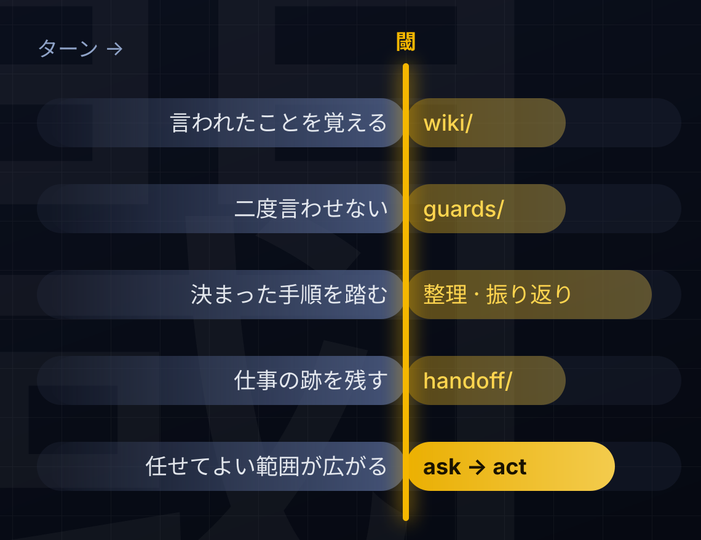
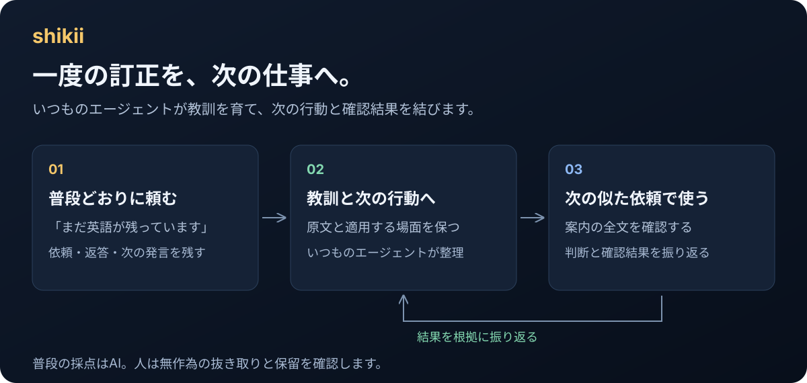
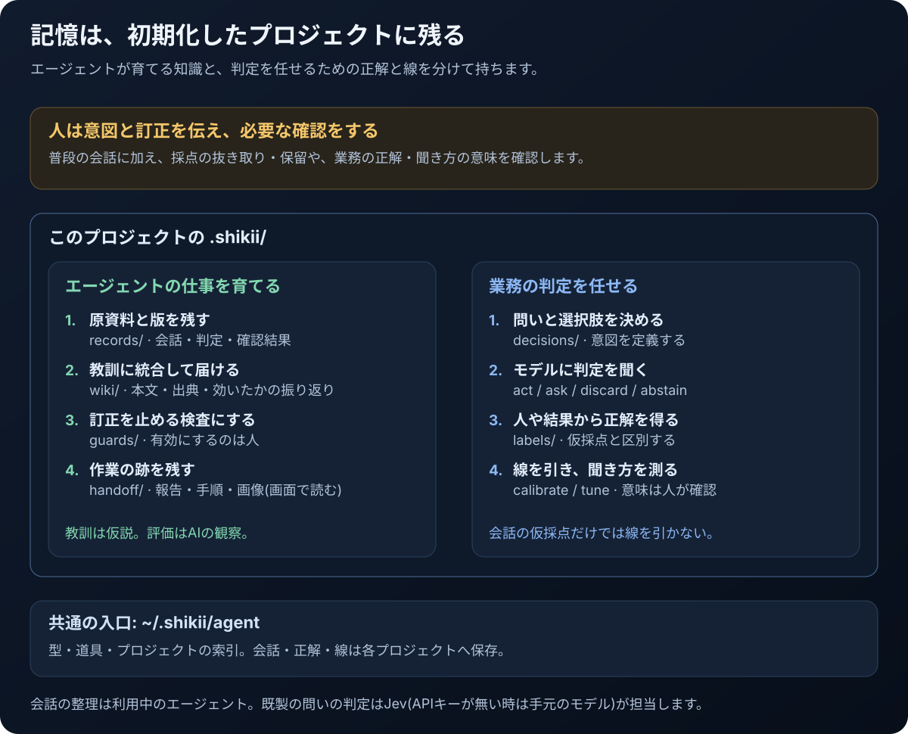

[English](../../README.md) · **日本語**

<p align="center"></p>

# shikii: エージェントを、あなたのプロジェクトに合わせて育てる

AIエージェントに仕事を任せると、同じ説明や訂正を何度もすることになりがちです。shikiiは、あなたが言ったこと・決めたこと・確かめたことをプロジェクトの `.shikii/` に残し、次の仕事の前にエージェントへ届けます。仕事が終わる時には、届いた知識が役立ったかと、新しく分かったことを記録させます。機械で確かめられる決まりは、エージェントが守るまで終われない検査にします。

育つのはモデルではなくプロジェクトの側なので、モデルを替えても知識は残ります。同じプロジェクトにつないだ Claude Code・Codex・OpenCode は、同じ知識を分け合います。

**言ったことを覚え、二度言わせず、任せられる範囲が広がる。**

[](../../go.mod)
[](../../.github/workflows/test.yml)
[](../../LICENSE)
[](../decision-ops-framework.ja.md)
[](../../CHANGELOG_ja.md)

**最近のバージョン**

- **0.44**: エージェントが記事に文を足すつもりで本文を消してしまう保存を断ります。少しずつ削る保存を重ねて、削り始める前の本文の半分以上がなくなる時も断り、足す時はまず `shikii wiki patch` で末尾に足すよう、その記事に合わせて埋めた patch の例を添えて伝えます。
- **0.42〜0.43**: 記憶のひと休み(`shikii nap`)。1日に1回まで、エージェントが記憶を見直し、元のファイルが変わった記事を読み直して、wiki に入れ損ねたあなたの訂正を書き足します。拾えた数は `shikii status` に出ます。
- **0.41**: 試しの実行などで終わったセッションが残した記録を、`shikii forget` で一覧を確かめてから消せます。

それより前のバージョンで足した物は[変更履歴](../../CHANGELOG_ja.md)に、メモリー機能との違いは[shikiiとメモリーの違い](../memory-and-learning.ja.md)にあります。

[困りごと](#困りごと) · [何が育つか](#何が育つか) · [人がすること](#人がすること) · [必要なもの](#必要なもの) · [始め方](#始め方) · [仕組み](#仕組み) · [業務の判定を任せる](#業務の判定を任せる) · [記憶はプロジェクトのもの](#記憶はプロジェクトのもの) · [もっと読む](#もっと読む)

<p align="center"></p>

## 困りごと

エージェントに仕事を頼むと、こうなりがちです。

- 一度直してもらったことを、次の仕事でまた直している
- 教訓を書き残しても、エージェントが読んだのか、読んで行動が変わったのかが分からない
- サブエージェントに任せた仕事には、その教訓がそもそも届かない
- 決まっていることを確かめずに作業を始め、学んだことを書き残し忘れる
- 前の仕事でやり残したことや、調べても分からなかったことが、次の仕事に引き継がれない
- 書き残した記憶が、いつの間にか古くなったり、消えたりしている
- 報告・メモ・画像がリポジトリに散らばるか、セッションが終わると消える
- AIの「たぶん、0.9」をどこまで信じて任せてよいのか、誰も測っていない

人が毎回同じ説明と訂正を繰り返すなら、AIに任せた意味がほとんどありません。

## 何が育つか

そのプロジェクトで長く働いた人のように、エージェントが次の5つを身につけます。

<p align="center"></p>

| 育つもの | shikiiがすること |
|---|---|
| 言われたことを覚えている | 訂正や決めたことが出典付きの教訓になり、似た仕事の前と、関係するファイルやコマンドの直前に届く |
| 同じことを二度言わせない | 機械で確かめられる訂正は「止める検査」になり、守るまでエージェントは終われない |
| 決まった手順を踏む | 依頼の前に要る知識をそろえて渡し、終える前に結果と学んだことを保存させる。やり残したことは次の仕事へ渡す |
| 仕事の跡を残す | 報告・リリースの記録・差分・画像を作業記録に残し、画面で読める |
| 任せてよい範囲が広がる | 正解が貯まるほど「ここより上なら当たる」線が引け、人に聞かずに進める判断が増える |

1. **言われたことを覚えます。** 普段の会話の訂正や決めたことから、エージェントが出典付きの教訓を wiki に書きます。教訓には、種類(このプロジェクトのルール・やり方・判断の基準・前提と事実・経緯)と、使う場面(「コミットする時」「請求書を出す時」など)が付きます。似た依頼の前には関係する教訓が最大2件届き、Claude Code と Codex では、教訓に名前が出てくるファイルを変える直前やコマンドを流す直前にも届きます。1つの話題は1つの記事にまとめ、新しい教訓をどの記事に入れるかは判定モデルが探します。
2. **同じことを二度言わせません。** 「変更履歴は英語と日本語を揃える」「この語は使わない」「コミット本文に元の問題と検証を書く」のように機械で確かめられる訂正は、止める検査になります。引っかかるとエージェントは終われず、直してから終えます。「許すまで push しない」のようなコマンドの検査は、Claude Code と Codex ではコマンドを流す直前に断ります。
3. **決まった手順を踏みます。** 依頼が来ると、今回の依頼・それまでの会話で決まったことと未決のこと・関係する教訓をそろえて、エージェントに渡します。エージェントは読んでから作業し、終える前に、結果と、届いた教訓が役立ったかと、学んだことを保存します。保存せずに終えようとすると、shikii が打つべき操作を返します。残りが減れば続きを促し、減らなければ未完了と表示して自動の続きを止めます。作業の記録に書いた「残っていること」は次の仕事の始めに届き、wiki で見つからなかった語は覚えておいて、また見つからない時に前の作業の記録を案内します。この確かめは組み込みで、`CLAUDE.md` や `AGENTS.md` の無いプロジェクトでも効きます。
4. **仕事の跡を残します。** 書き換えながら進める監査の報告・リリースの手順・差分・画像は `.shikii/handoff/<仕事>/` に入り、サブエージェントにも報告をここへ書くよう伝えます。リポジトリにはコミットされず、画面の「知識 → 作業記録」で読めます。
5. **任せてよい範囲が広がります。** モデルは「たぶん0.9」と確率を返します。shikii は、人と結果が付けた正解から、モデルの自信と当たる割合の関係を測り、「ここより上なら自動で進めてよい」という線を引きます。線が引けるまでは自動では動きません。正解はモデルとは別に残るので、モデルを替えても最初からやり直しません。

効いているかは、画面の「AI の様子」と `shikii status` で見ます。届けた教訓が役立ったか、手順を踏んだターンの数、止める検査が止めて直った数、人を待つ判定の数、引けた線が出ます。

## 人がすること

- **普段どおりエージェントを訂正する。** 会話の中で「まだ英語が残っている」と言えば十分です。エージェントが教訓にし、機械で確かめられる訂正なら、止める検査の草稿(無効)も置きます。
- **止める検査を有効にする。** `shikii guard enable <id>` を一度打ちます。shikii は、その検査がわざと壊した例で止まり、正しい例で通ることを見せてから有効にします。外すのもあなたの判断です。
- **いくつかの答えを付ける。** 画面の「答える」に、モデルが迷った判断と、自動で進めた判断の20件に1件が、1枚ずつ出ます。会話を読んで、本当はどうだったかのボタンを押します。
- **知りたい時に知識を引く。** 画面の「知識」の一番上の「いつも守ること」に、このプロジェクトで決めたルールが並びます。場面を選ぶと、その場面に効く教訓が種類ごとに並びます。全部を確かめる必要はありません。「あなたに見てほしいもの」に、害があった教訓や繰り返された訂正のような例外だけが出ます。
- **知識を編集・削除する。** 記事を開いて「編集」「削除」を選べます。削除すると検索や配信から外れ、出典と履歴は残ります。あなたの編集は、エージェントの保存にかかる断り(下の「知識の手入れ」)の対象外です。
- **読みたい時に作業記録を読む。** 画面の「知識 → 作業記録」で、エージェントの報告を読み、画像を見られます。
- **聞き方が変わった時に確かめる。** エージェントが問いの聞き方を変えると、「答える」に知らせが出ます。「このままでよい」か「元に戻す」を選びます。
- **整理や見直しを頼む。** 「shikiiを整理して」と頼むと、エージェントが wiki の文章を出典と照らし、言い過ぎや同じ説明の繰り返しを直します。「shikiiを最適化して」なら、整理に続けて、今のバージョンの書き方に合わせて記事を原資料と照らして見直します(見直しだけなら「記憶を更新して」)。

それ以外は機械の仕事です。

## 必要なもの

| やりたいこと | 必要なもの |
|---|---|
| 普段の会話から学び、訂正を検査にする | Claude Code、Codex、またはOpenCode 2.x、shikii、利用するプロジェクトでの `shikii --init`。教訓はサブエージェントにも届く |
| 既製の問いに答えさせる | 推奨: TypeSafeのJev（環境変数 `TYPESAFE_API_KEY`。取得するものは無い）。APIキーを置けない時: llama.cpp（`llama-server`）とTernary-Bonsai-27Bを `shikii up` で立てる構成（取得 約7.6GB、動作中のメモリ約10GB） |
| 業務の判定に別のモデルを使う | 下の表のSystem One形式の接続先 |
| インストールする | macOSかLinux（amd64かarm64）、sh、curl、tar、awk、shasumかsha256sum（どちらのOSにも初めからある）。Goは不要 |
| ソースからインストールする | Go 1.27以上、Git、sh。画面は同梱済みでNode.jsは不要 |
| コンテナで業務のAPIと画面を動かす | DockerとCompose、またはPodmanとCompose provider（[準備](../../integrations/docker.ja.md)） |
| APIキーやGPUなしで一周試す | Go 1.27以上と同梱の偽モデル（`scripts/demo.sh`） |

| 接続先 | 準備するもの |
|---|---|
| Jev（TypeSafe AI） | 推奨。`TYPESAFE_API_KEY`。APIキーがあれば、既製の問いと、`send_to` に `hosted` を含む業務の判定がここへ送られる。[公式仕様](https://docs.typesafe.ai/introduction/quickstart) |
| llama.cpp | APIキーを置けない時。通常のチャットGGUFを同梱の `shikii-readout` 越しに（手元の標準はTernary-Bonsai-27B。`shikii up` が両方を立てる）。OpenJevのような学習済みの決定モデルはそのまま通す。Kev-4Bは使えない。[実行例](../../integrations/readout.ja.md) |
| Ollama / LM Studio | `/v1/systemone` と決定モデル。業務の判定向け。このバージョンでは未検証 |

## 始め方

### 1. TypeSafeのAPIキーを置く（推奨）

[TypeSafe AI](https://docs.typesafe.ai/introduction/quickstart)でAPIキーを取得し、シェルとエージェントの環境変数に置きます（`export TYPESAFE_API_KEY=…`）。取得するものはなく、普通のPCで動きます。APIキーがあれば、hookも既製の問いもJevへ送り、手元のモデルは起こしません（`shikii up` も起こしません）。既製の問いのために、依頼文・エージェントの返答・wikiの教訓がTypeSafeへ送られます（手元の記録にも残ります）。

どちらのモデルを使うかは、プロジェクトごとにも選べます。画面(メニューの「設定」)か `shikii init --model local` / `shikii init --model hosted` です。`local` を選んだプロジェクトは、APIキーがあっても依頼・返答・ファイルの抜粋を機械の外へ出しません。選んだ物は `.shikii/project.json` に残り、環境変数 `SHIKII_MODEL`(`local` か `hosted`)とAPIキーより先に効き、`--model` を付けずに `shikii init` をやり直しても変わりません。

**APIキーを置けない時はllama.cppです。** 手元のモデルを動かします。27Bのモデルなので動作中のメモリが約10GB要り、普通のPCでは重いことがあります。macOSでHomebrewなら:

```sh
brew install llama.cpp
llama-server --version
```

macOS以外は[llama.cppの公式の手順](https://github.com/ggml-org/llama.cpp/blob/master/docs/install.md)を参照してください。手元の基本モデルは **Ternary-Bonsai-27B Q2_g64**（`prism-ml/Ternary-Bonsai-27B-gguf`、Apache 2.0。取得は約7.6GB、動作中のメモリは約10GB）です。`shikii up` がllama-serverを `:8086` に、`shikii-readout` を `:8080` に立てるので、hook・MCP・画面は常に `:8080` を見ます。他のGGUFも同じ形で使えます（`shikii up --gguf <file>`）。

### 2. shikiiをインストールする

```sh
curl -fsSL https://raw.githubusercontent.com/hayaenfj/shikii/main/install.sh | sh
```

インストーラーは、GitHub Releasesからこの機械向け（macOSかLinux、amd64かarm64）の最新バージョンを取ってきて、バージョンの `SHA256SUMS` と照らしてから、`shikii` と `shikii-readout` を `~/.local/bin` に置きます。Goは要りません。実行ファイル、hook（依頼の前・作業の後・サブエージェントの始まりと終わり・ファイルの変更とコマンドの直前）、エージェントの作法を入れ、PATHに足す必要があれば案内します。Codexでは `/hooks` でhookを信頼してください。hookの中身が変わるたび(実行ファイルを動かした時やshikiiをアップデートした時)にもう一度信頼が要り、それまでCodexはhookを飛ばします。

**Go 1.27以上がある場合。** 両方の実行ファイルを、Goのバージョンを上げても残るフォルダへ直接入れられます。

```sh
mkdir -p "$HOME/.local/bin"
GOBIN="$HOME/.local/bin" go install github.com/hayaenfj/shikii/cmd/shikii@latest
GOBIN="$HOME/.local/bin" go install github.com/hayaenfj/shikii/cmd/shikii-readout@latest
export PATH="$HOME/.local/bin:$PATH"
shikii hook install --yes
```

シェルの設定でも `~/.local/bin` をPATHに加え、続けて手順3で利用するプロジェクトを初期化してください。バージョンを指定する時は、両方のコマンドの `@latest` を `@v0.44.2` のようなタグへ置き換えます。

Goを上げた後や実行ファイルを動かした後にhookが働かなくなったら、上のインストーラーのコマンドをもう一度流してください。多くは実行ファイルそのものが消えています(miseのようなGoのバージョンの管理ツールでは、Goを上げると `go install` が置いたバージョンごとのフォルダごと消えます)。`shikii` がまだ動く時は `shikii doctor` が、hookやCodexの登録が動かせないshikiiを指していないかを確かめ、直し方を出します。

**前に `go install` でGoの既定フォルダへ入れた人へ。** その実行ファイルはGoのフォルダ(`$(go env GOPATH)/bin` か `GOBIN`)に残り、`shikii update` もそこでアップデートするだけで、`~/.local/bin` へは移しません。上のインストーラーのコマンドを一度流すと、hookは `~/.local/bin/shikii` を動かすようになります。先に `~/.local/bin` がPATHにあることを確かめてください(無ければインストーラーがそう言います)。Claude CodeとOpenCodeのMCPは `shikii` を名前で動かします。そのあとGoのフォルダの古い `shikii` と `shikii-readout` を手で消し、もう一度 `shikii hook install --yes` を流してください。それまでは実行ファイルが2つあり、端末で打つ `shikii` と、Claude CodeとOpenCodeのMCP(`shikii` を名前で動かす)は、PATHで先に見つかる方を動かし(`command -v shikii` でどちらかわかります)、`shikii update` はその1つだけをアップデートし、CodexのMCPの登録は古い実行ファイルが残る間はそちらを指したままです。

**ソースから組む（開発する人向け）。** このリポジトリをcloneした中で `sh install.sh` を流すと、今のソースをGo 1.27以上で組んで同じ `~/.local/bin` に置き、hookも同じように入れます（`make install` は組んで実行ファイルを写すだけです）。

### 3. 利用するプロジェクトを初期化する

使いたいプロジェクトで、エージェントにこう頼みます。

> このプロジェクトでshikiiを使って

エージェントが `shikii init` を実行します(`shikii --init` と同じで、自分で実行しても同じです)。shikiiは、初期化したプロジェクトだけで動きます。

`shikii init` がすること:

- プロジェクトに `.shikii/` を作り、既製の問い・wiki・止める検査の置き場・作業記録の置き場を用意します。`.shikii/` には私的な会話が入るので、Gitの除外に入れます。
- エージェントがshikiiを呼べるように、MCPの設定を足します。プロジェクトに `.mcp.json` と `opencode.json` を足し、`AGENTS.md` と `CLAUDE.md` には書きません。MCPを共通の `~/.codex/config.toml` からしか読まないCodexには、プロジェクトを書かない共通の登録を1つ書き、道具を呼ぶたびにエージェントの作業フォルダを `project` で渡します。この登録には `default_tools_approval_mode = "approve"` を書くので、Codexはshikiiの道具を、呼ぶたびに確認せずに実行します。確認してほしい時は、そこを `"prompt"` と書くか、行を消します。shikiiが足し直すことはありません。
- エージェントの作法(skill)を置きます。
- この機械で最初のプロジェクトで、shikiiのhookが1つも入っていない時は、hookも入れます(`shikii hook install --yes` と同じ。TypeSafeのAPIキーが無く `llama-server` が入っている機械では、手元のモデルを裏で起動します)。すでにプロジェクトがあってhookが無い機械では、hookは入れずに、入れるコマンドを表示します。
- 何度実行しても同じ結果になり、あなたが書いた設定や記録は消しません。

`shikii init` には選ぶものが無いので、`--yes` のような引数は受け付けません(付けると、引数は要らないと断ります)。`--yes` を付けるのは、変える前に一覧を見せるコマンドです。

| コマンド | `--yes` 無し | `--yes` 付き |
|---|---|---|
| `shikii hook install` | 足すhook・プラグインの一覧を出すだけ | 入れる |
| `shikii uninstall` | 外す物の一覧を出すだけ | 外す |

答え合わせの画面はプロジェクトごとに1つで、最初の依頼のhookが空いているポートで起こしてブラウザで開きます(URLは `shikii page`)。`shikii doctor` で状態を確かめます。

プロジェクトの下に置いた作業ツリー(Claude Code の `.claude/worktrees/`、chiten の `.chiten/wt/` など)では、shikii が上へたどって元のプロジェクトを見つけ、同じ wiki・止める検査・記録を使います。作業ツリーごとに初期化する必要はありません。

**OpenCodeについて。** OpenCode 2.xにはhookの設定ファイルが無いので、`shikii hook install --yes`(と、この機械で最初の `shikii --init`)が、小さなプラグインを `~/.config/opencode/plugins/shikii/` に置きます(`$XDG_CONFIG_HOME` が絶対パスの時は、その下の `opencode/` です)。Claude CodeやCodexと同じhookを動かすので、依頼の前にshikiiの教訓がモデルに届き、必要な記録が残っていなければ、回の終わりに続きを促します。この終了時の確認は、OpenCode の試験段階の hook(OpenCode 2.3.0)を使って回の中で動くので、TUI でも `opencode run` でも動きます。その hook を動かさない OpenCode では回が終わった後にしか確認できず、自前のサーバーで動く `opencode run`(`--standalone`、または常駐のサービスが動いていない時)はその時にはもう終わっています。同じ名前のあなたのフォルダは上書きせず、リンクもたどらず、その旨を表示して残します。`OPENCODE_CONFIG_DIR` を設定して起こしたOpenCodeは、そのフォルダの `plugins/` からだけプラグインを読むので、shikiiのプラグインを読みません。shikiiはそこへは書かず、`shikii doctor` がそう知らせます。OpenCode 1.xはこのフォルダを読まず、これまでどおりMCPの設定とskillだけを使います。shikiiのプラグインはコマンドの前のhookを持たないので、コマンドを拒む止める検査はOpenCodeでは動きません(終了時の確認は動きます)。shikiiのプラグインはあなたへ文も見せないので、Claude CodeやCodexで表示するshikiiの文(止める検査の説明、答えを待つ数、自動の続きを止めた知らせ)は、OpenCodeには出ません。入れた後はOpenCodeを開き直してください。

**`OPENCODE_CONFIG_DIR` を使うOpenCodeについて。** それを設定して起こしたOpenCodeにshikiiのプラグインを読ませるには、そのフォルダの `plugins/` へ、shikiiのフォルダのリンクを自分で置きます: `mkdir -p "$OPENCODE_CONFIG_DIR/plugins" && ln -s ~/.config/opencode/plugins/shikii "$OPENCODE_CONFIG_DIR/plugins/shikii"`(`shikii doctor` があなたのパスでこのコマンドを出します)。リンクはあなたの物なので、`shikii uninstall` は残します。外した後は自分で消してください。

### 4. 前のメモリをshikiiに移す(任意)

Claude CodeやCodexのメモリーに、このプロジェクトのことがすでに書いてあるなら、エージェントにこう頼みます。

> メモリをshikiiのwikiへ移して

一度頼めば十分で、ファイルを先に仕分ける必要はありません。エージェントは次のように移します。

- 読むのは、Claude Codeのメモリー(`~/.claude/projects/<プロジェクト>/memory/`)と、Codexのメモリー(`~/.codex/memories/`)のうちこのプロジェクトに関わるファイルです。ほかのプロジェクトのファイルには触りません。秘密と、会話の記録そのものは移さずに残します。
- 各ファイルの本文を、そのままwikiの原資料として控えます。
- そこから出典付きの教訓を作り、同じ話題の記事がすでにあれば、その記事にまとめます。使わない語のように機械で確かめられる決まりは、止める検査の草稿(無効)も置きます。
- 元のメモリーのファイルは消さず、本文も変えません。各ファイルに、移した先のwikiの記事を示す1行だけを足します。どの依頼にも効く決まり(言葉の決まりなど)は、元の索引にも残します。

まだ移していないファイルがあると、hookがセッションに1回、その数とファイル名を知らせます。

### アップデート

```sh
shikii update
```

`shikii update` は最新の安定バージョンを取得し、ハッシュを確かめ、shikiiとreadoutを置き換えます。置き換えたshikiiを、shikiiのhookかOpenCodeのプラグインのどれか1つが動かしていれば、updateは続けて `shikii hook install --yes` を自分で実行し、3つのエージェント全部(Claude Code・Codex・OpenCode)のshikiiのhookを書き直します。手で外したhookも戻ります。新しいバージョンがエージェントの設定に加える変更も、表示しながら反映します。この段で失敗した時はupdateがそう言うので、`shikii hook install --yes` を実行してください。hookを使わない場合は、代わりに初期化済みのプロジェクトで `shikii --init` を実行し直します。データは残り、hookは無効のままです。

同じプロジェクトへ書く機械やプロセスがほかにもあれば、全部の shikii を同じバージョンにしてください。0.44.1 からは、エージェントが行を削った記事に、比べる元になる記事のバージョンの記録が付きます。0.44.0 以前の shikii はこの記事を読めず、アップデートするまで wiki への保存(`shikii wiki ingest`・`shikii reflect submit`・`shikii wiki patch`)を全部断ります。記事そのものは壊れません。アップデートの後は、エージェントのセッションを開き直し、画面とMCPを再起動します。0.7.0以降からのアップデートでは既存の記録が残りますが、**0.6.0以前からのアップデートは消します**(下の注意を見てください)。新しいバージョンで記事の書き方の方針が変わった時は、原資料を残したまま既存の記事を見直す作業(記憶の更新)が、作業の区切りに少しずつエージェントへ届きます。詳しくは[記憶と学習](../memory-and-learning.ja.md)を参照してください。

<details>
<summary>古いバージョンからアップデートする時の注意(0.6.0〜0.31.0)</summary>

**0.6.0以前からのアップデートは、初期化済みの各プロジェクトの `.shikii/` の中を全部消して初期化し直します。** 以前の会話・教訓・正解・線は消えます。残したいものは先に控えてください。0.7.0以降からのアップデートでは残ります。

0.8系からのアップデートでは、開いているエージェントのセッションも開き直し、同じwikiを使う機械を全部0.9.0以上にします。0.8系のshikiiは種類と場面を付けた記事を読めず、wikiへの保存を断ります(記事は壊れません)。同じように、0.9.1以前は0.9.2が書いた記事(記事のファイルの決まった語が英語)を「変更あり」と見なすので、同じwikiを使う機械は全部0.9.2以上にします。

0.9.2以前からのアップデートでは、古いshikiiが書いたCodexの登録をそのまま残します(0.9.7から書き直しません)。initとアップデートが、代わりに書く節を出します。`args = ["mcp", "--local", "http://127.0.0.1:8080"]`(全部のプロジェクトで1つの登録)の形です。直した後はCodexを開き直してください。直すまでは、`--store` で1つのプロジェクトを指す節のままなら、どのCodexのセッションもその1つのプロジェクトを使います。古いshikiiが `AGENTS.md` に足した節も残し、initとアップデートが手で消す範囲を知らせます。

0.9.6からのアップデートでは、この機械に登録された全プロジェクトに、置き場のidを1回だけ書きます。アップデートの後に移したプロジェクトのフォルダは、自分でつなぎ直ります(アップデートの前に移した物はつなぎ直りません。hookがそう知らせ、そこで `shikii --init` すればwikiと記録はそのまま使えます)。機械を全部上げ、エージェントのセッションを開き直してください。古いshikiiがプロジェクトをもう一度登録すると、hookがそう知らせ、全部のshikiiを上げるよう頼みます。

0.28.0へアップデートした後は、同じwiki・進行中のセッション・担当割り当ての記録を書く全プロセスをアップデートし、セッション・画面・MCPを再起動してください。旧バージョンは新しい読取計測・品質報告の進捗を保持できません。0.27.0からのアップデートではデータと既存の記事・実行結果を保持します。条件に合う結果の選択には0.25.0以降が必要です。chitenから実利用・実行結果を返す場合は、対応するchitenも別途必要です。0.24より前の書き手は担当のcontextやイベントとreceiptの対応を保持できず、0.22より前の本体では学び付きの記事を読めません。旧バージョンへ戻す必要がある場合は、アップデートの前の`.shikii/`を控え、本体とデータを一緒に戻せるようにしてください。

0.31.0からは、shikiiが書いたCodexの登録に `default_tools_approval_mode = "approve"` を足し、Codexがshikiiの道具を、呼ぶたびに確認せずに実行するようになります。hookを使わない場合は、初期化済みのプロジェクトで `shikii --init` を実行し直すと、同じ行が足されます。

</details>

### 終わったセッションの残した記録を消す

```sh
shikii forget <セッション id>          # 消す物・残す物とその理由の一覧を出すだけで、何も変えない
shikii forget <セッション id> --apply  # 消す。控えを .shikii/records/forgotten/ に残す
```

エージェントの試しの実行や、間違えて始めたセッションは、`.shikii/` に記録を残します。`shikii forget` は、記録が名指している id をたどってそれを探します。wiki の記事が引いている原資料と、人が答えた判断は残し、まだ動いているかもしれないセッションは断ります。エージェントは MCP から頼むこともできます。その時は shikii があなたに直接、消してよいかを聞き、あなたが同意した時だけ消します。詳しくは[手引き](../guide.ja.md)を見てください。

### アンインストール

```sh
shikii uninstall        # 外す物の一覧を出すだけで、何も変えない
shikii uninstall --yes  # 外す
```

shikiiがエージェントに入れた物を外します。`~/.claude/settings.json` と `~/.codex/hooks.json` のshikiiのhook、OpenCodeのプラグインのフォルダ `~/.config/opencode/plugins/shikii`(shikiiが置いた物だけ。ほかのプラグインは残ります)、`~/.codex/config.toml` の `[mcp_servers.shikii]`、初期化した各プロジェクトの `.mcp.json` と `opencode.json` のshikiiの項目、`~/.claude/skills/shikii` と `~/.agents/skills/shikii` のエージェントの作法です。プロジェクトの答え合わせの画面も止めます。ほかのhook・MCP・設定、ファイルそのもの、`AGENTS.md` と `CLAUDE.md` は残ります。データも残ります。各プロジェクトの `.shikii/` と `~/.shikii/agent` は消さず(止めた画面の記録だけは消します)、もう一度インストールすればその続きから使えます。実行ファイルは消しません。最後に、そのパスを入れた `rm` のコマンドを出します。外した後は、開いているClaude Code・Codex・OpenCodeのセッションを開き直してください。

## 仕組み

<p align="center"></p>

### 1回の依頼の流れ

hookを入れると、shikiiは人の依頼1つと、それに対するエージェントの作業と返事を1回として、次の時に動きます。

1. **セッションの始め。** どの依頼にも効く決まりと、進んでいる作業の様子を渡します。前の見直しから24時間以上たち、終わった依頼が5件以上あれば、記憶のひと休み(`shikii nap`)を頼みます。
2. **依頼の前。** 依頼を控え、今回の依頼、それまでの会話、関係する教訓、前の作業が残したこと、見直しを待つ記事をそろえてエージェントに渡します。前の依頼の続きだけの発言(「ok」「続けて」など)は前の依頼にまとめます。決定モデルには「始める前に進め方を合わせるべきか」を聞きます。
3. **作業の途中。** Claude CodeとCodexでは、ファイルを変える直前とコマンドを流す直前に、その名前が出てくる教訓を渡し、有効にしたコマンドの止める検査はその場で断ります。サブエージェントには、起こす時にいつもの決まりを渡し、仕事に要る物はサブエージェントが自分でwikiを探します。エージェントは、話題が移った時や迷った時に、wikiを探し直したり、決定モデルに聞いたりできます。
4. **終える時。** 結果の保存、届いた教訓の振り返り、記事の分類、返事の言語がそろっているかを確かめ、止める検査をそのターンで変わったファイル・足した行・コミットに当てます。足りない物があれば、具体的な操作をエージェントへ返します。そろってから、決定モデルに「変更は範囲内か」「頼まれたことを終えたか」を聞いて記録します。
5. **次の依頼の時。** 前の答えに、その後に起きたことから正解が付きます。次の依頼までに戻された変更、言い直された依頼、まとめられた・置き換えられた教訓、振り返りで役に立った・使われなかったと評価された教訓です。結果で答えが決まらない問いだけが、人の答えを待ち、その数は画面に出ます。

### 決定モデルに聞くこと

決定モデルは、文章を書かずに、はい/いいえや選択肢の確率だけを返すモデルです。推奨はTypeSafeのJevで、APIキーを置けない時は手元のTernary-Bonsai-27Bを使います。shikiiは、エージェント自身の仕事についての次の問いを初めから持っています。

| 問い | 聞く時 |
|---|---|
| 始める前に、進め方を人と合わせるべきか(`needs-plan`) | 依頼の前 |
| 届けようとする教訓は、今の仕事に当てはまるか(`lesson-applies`) | 教訓を届ける前 |
| 新しい教訓はどの記事に入れるか、前の教訓と食い違わないか | 教訓を保存する前 |
| 変えたファイルは、頼まれた範囲に収まっているか(`changes-in-scope`) | 終える時 |
| 頼まれたことを終えたか(`done-as-asked`) | 終える時 |

`shikii init` は、shikii の上に作った道具のための問いも1つ各プロジェクトに入れます。「報告のこの主張を、引いたファイルのこの一節は支えているか」(`quote-supports`)です。chiten は、調査報告の引用について、これを聞きます。プロジェクトのファイルの抜粋を、プロジェクトが選んだモデルへ送ります。

これらの答えが助言として届くのは、線が引けてからです。どの答えも、エージェントの道具の実行を止めることはありません。判断はすべて4つに分かれます。`act` は自動で進める、`ask` は人に確かめる、`discard` は動かない、`abstain` は入力か接続先が足りない、です。線が引けた時と、正解が足りても線を引けない時は、ターンの終わりに一度だけ知らせます。

### 止める検査

止める検査は決定モデルではなく、決まった規則です。ターンの終わりに、そのターンで変わったファイル・足した行・コミットに当てます。流してはいけないコマンドの検査は、Claude CodeとCodexではコマンドを流す直前にも断ります。種類は4つです。

| 種類 | 止める時 | 例 |
|---|---|---|
| `paired-files` | 片方のファイルが変わったのに、もう片方が変わっていない | `CHANGELOG.md` と `CHANGELOG_ja.md` |
| `forbidden-words` | 足した行に使わないと決めた語がある | 言い換えを決めた語。例外のパスは見ない |
| `commit-body` | そのターンのコミットの本文に決めた語が無い | 「元の問題」「変更後」「検証」 |
| `forbidden-commands` | 実行前のコマンドが規則に合う | 公開を許可するまで `git push` を断る |

エージェントは訂正から草稿を置き（`shikii guard add`、無効）、人が `shikii guard enable <id>` で有効にします。有効にする時、shikiiはその検査がわざと壊した例で止まることと、正しい例で通ることを先に見せます。引っかかったターンはエージェントが終われず、直してから終えます。同じ検査が同じターンを止めるのは1回だけで、その後の続きでは止めず、直ったかだけを記録します。

### 知識の手入れ

教訓は書いて終わりではなく、使われ方を見て直していきます。

- **役に立たない教訓は届けない。** 同じ場面で繰り返し使われなかった教訓や、判断を妨げた教訓は、判断と証拠を付けて見直しに回ります。エージェントが出典を確かめてから直し、変えなくてよいという判断も残せます。
- **あなたの過去の答えも同じ。** 似た依頼の前に示すあなたの過去の答えも、役に立たなければ示さなくなり、画面の「AI が無効と判断した過去の答え」に並びます。画面から元に戻せます。
- **記事をうっかり消させない。** エージェントが既存の記事に保存する時、本文の半分以上がなくなる保存は断ります。少しずつ削る保存を重ねた時も、削り始める前の本文と比べて断ります。足す時は、本文の末尾に文を足す `shikii wiki patch` を使うよう伝えます。前のバージョンはいつも履歴に残ります。
- **1日に1回までの見直し。** 前回から24時間以上たち、終わった依頼が5件以上になると、セッションの始めにエージェントが記憶を見直します(`shikii nap`)。元のファイルが変わった記事を読み直し、あなたが最近伝えた訂正のうち、wiki にまだ無いものを書き足します。拾えた数は `shikii status` で見られます。
- **やり残しと分からなかったことを引き継ぐ。** 作業の記録の「残っていること」は、次の作業の始めに届きます。wiki で見つからなかった語は覚えておき、同じ語でまた見つからない時に、その話が書いてある前の作業の記録を案内します。
- **経験を手順に育てる。** 前に使った手順は、その時の条件・失敗・直し方と一緒に読み、今回の条件と比べます。前の成功を、そのまま今回の成功とは見なしません。読む量や調査の進め方も、実際の結果から選び直します。
- **エージェントの間で分け合う。** 同じプロジェクトにつないだClaude Code・Codex・OpenCodeは、同じwikiを使います。ひとりの発見をほかの担当に届け、別の条件で確かめて、同じ知識に戻します。
- **バージョンが上がった時の見直し。** 記事の書き方の方針が変わると、作業の区切りに既存の記事を少しずつ、原資料と照らして見直します。

別に使う道具のchitenと組むと、chitenが報告した知識の実際の使用と手順の結果も、同じ記録に入ります(任意)。詳しくは[メモリーとの違い](../memory-and-learning.ja.md)と[ガイド](../guide.ja.md)にあります。

### 誰が何をするか

| 仕事 | 普段の担当 | 人の分 |
|---|---|---|
| 会話からの教訓 | いつものエージェント | 普段の会話で訂正する |
| 教訓の差し込み先、範囲、完了 | 決定モデル。正解は結果から | 抜き取りと保留を確かめる |
| 止める検査 | 決まった規則。草稿はエージェント | 有効にするか決める |
| 作業の前と後の手順 | エージェント。組み込みの規則が確かめる | なし |
| 記憶の見直し | エージェント(1日に1回まで) | なし |
| 作業記録 | エージェントとサブエージェント | 読みたい時に画面で読む |
| 業務の正解 | 人 | 正解を付ける。エージェントが変えた聞き方の意味が違っていたら元に戻す |

[Andrej KarpathyのLLM Wiki](https://gist.github.com/karpathy/442a6bf555914893e9891c11519de94f)の考え方に沿い、原資料を残してエージェントが取り込み・検索・見直しを担います。詳しくは[hook](../../integrations/claude-code.ja.md)、[wikiの作法](../../skills/shikii/references/wiki.md)、[止める検査の作法](../../skills/shikii/references/guards.md)。

## 業務の判定を任せる

自分の仕事の判断（「この問い合わせは前のと同じ案件か」など）も、同じ仕組みで少しずつ任せられます。判定のファイルに質問・選択肢・入力・しきい値を書き（`shikii new`、または[既製の判定](../../decisions/README.md)を写す）、答えを付けていくと、ある自信より上なら当たると言える線が引けます。線が引けるまでは、全部が人に確かめる側に回ります。

cloneした中で（例の判定はインストーラーには入っていません）:

```sh
shikii new same-issue --from decisions/same-issue.yaml              # 例の判定を .shikii/decisions/ に写す
SHIKII_MODEL=local shikii up                                     # この例の問いは pii: true なので手元のモデルが要る。APIキーがあると up は SHIKII_MODEL=local の時だけ起こす
shikii decide .shikii/decisions/same-issue.yaml -i report1="…" -i report2="…"   # --local が無い時は、http://127.0.0.1:8080 の手元のモデル(shikii up が起こす物)を使う
#   → band=ask   （線がまだ無いので人が決める）
shikii serve --local http://127.0.0.1:8080                       # 答え合わせの画面: http://127.0.0.1:8095
#   正解が必要な数（eval.min_n）に届くと、線は自動で引かれる
shikii decide .shikii/decisions/same-issue.yaml -i report1="…" -i report2="…" --local http://127.0.0.1:8080
#   → band=act   記録付き: 何件の正解、何件を人が確かめ、act側の精度はいくつか
```

| 判断 | すること |
|---|---|
| `act` | 線の条件を満たしたので自動で進める |
| `ask` | 人に確かめる |
| `discard` | 動かない |
| `abstain` | 足りない入力か接続先を揃える |

線は質問とモデルの組ごとに持ち、どちらかが変われば測り直します。過去の案件の表(CSV)から正解を取り込む `shikii import` や、大きいモデルに同じ問いを聞き、人の正解とよく合う時だけその答えを正解に足す `shikii judge` もあります。`shikii tune` は貯めた正解で別の聞き方を採点し、`shikii drift` と `shikii check` はずれたモデルや弱められた線を捕まえます。APIキーやGPUなしで試すなら、cloneした中で `scripts/demo.sh` を実行します。

- [既製の判定](../../decisions/README.md) · [業務の例](../examples/inquiry-route.ja.md) · [全コマンドとHTTP API](../guide.ja.md) · [MCP](../../integrations/mcp.ja.md) · [測った数字](../bench.ja.md)

## 記憶はプロジェクトのもの

会話・教訓と原資料・仮採点・正解・線・止める検査・作業記録は、そのプロジェクトの `.shikii/` に入ります。関係ないプロジェクトとは分かれます。作業ツリーで作業しても、wikiと作業記録は元のプロジェクトのものを使います。プロジェクトの下に置いた作業ツリーでは、shikiiが自分で元のプロジェクトを見つけます。ほかの場所に作った作業ツリーでは、エージェントが元のプロジェクトを指定します。共通の `~/.shikii/agent` には雛形・道具・プロジェクトの一覧があります。`.shikii/` には私的な会話が入るので、初期化がGitの未追跡ファイルから除きます。

<p align="center"></p>

```text
.shikii/
  decisions/  決定モデルへの問いと、引いた線
  wiki/       教訓・条件・以前のバージョン
  guards/     人の訂正から作った止める検査
  records/    会話・判定・採点・配送・観察・検査の結果と、教訓の原資料
  labels/     人と結果が付けた正解
  sessions/   セッションごとの控え(届けた教訓、伝えた知らせ、変わったファイル)
  handoff/    作業記録: 監査の報告、リリースの手順、差分、画像(画面で読む)
```

## もっと読む

- [shikiiとメモリーの違い](../memory-and-learning.ja.md): 覚えること、役立ったかを確かめること、判断を任せること
- [ガイド](../guide.ja.md): 全コマンド、HTTP API、モデルの接続、業務の判定の作り方
- [構造の説明](../architecture.ja.md)
- [エージェントの作法](../../skills/shikii/SKILL.md)
- [変更履歴](../../CHANGELOG_ja.md)

**開発に加わる人へ**: テストはわざと壊して落ちるのを見てから直します。観察と正解を分け、数字は測ったものだけを書きます。設定を増やすより、決まった置き場と規則で済ませます。

## ライセンス

[Apache-2.0 OR MIT](../../LICENSE)。[Apache 2.0](../../LICENSE-APACHE)か[MIT](../../LICENSE-MIT)を選べます。第三者の依存・同梱コード・モデル・外部サービスのライセンスは別です。配布物には3つのライセンスファイルと第三者の表示を含めてください。
