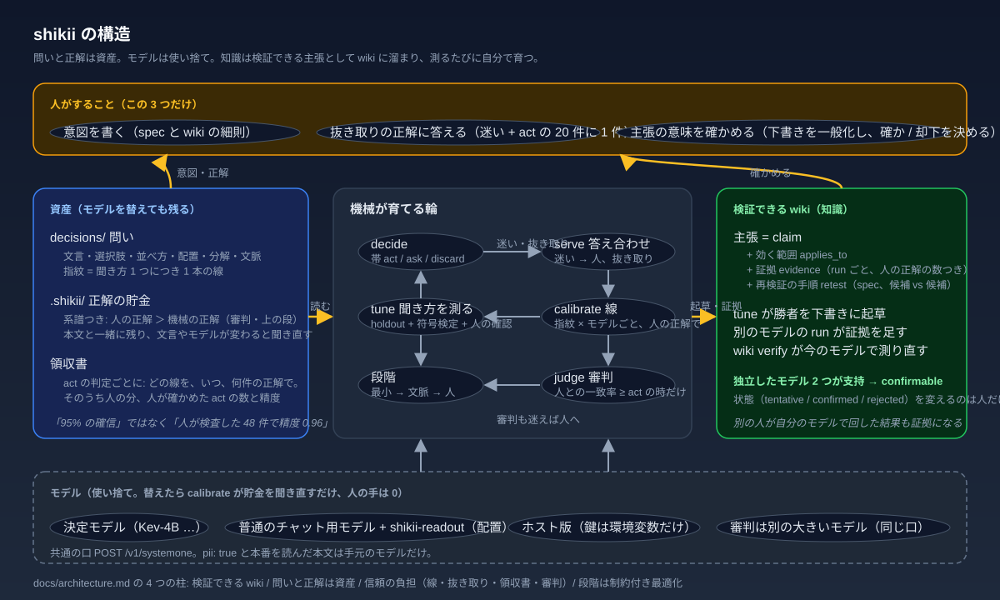

[English](../../README.md) · **日本語** · [简体中文](README_zh.md) · [繁體中文](README_zh-TW.md) · [한국어](README_ko.md) · [Deutsch](README_de.md) · [Español](README_es.md) · [Français](README_fr.md) · [Italiano](README_it.md) · [Português (Brasil)](README_pt-BR.md) · [Русский](README_ru.md) · [Українська](README_uk.md) · [Polski](README_pl.md) · [Türkçe](README_tr.md) · [Tiếng Việt](README_vi.md) · [Bahasa Indonesia](README_id.md)

<p align="center"></p>

# shikii: AI の「たぶん」を、仕事で使える「大丈夫」に変える

### AI に「はい / いいえ」「どれ」「どの程度」を決めさせて、業務で使い続けるための道具。あなたがするのは、答え合わせと、たまに「これで合ってる？」に答えることだけ。

[](../../go.mod)
[](../../.github/workflows/test.yml)
[](../../LICENSE)
[](../operations.md)

[困りごと](#困りごと) · [shikii がすること](#shikii-がすること) · [あなたがすること](#あなたがすること) · [インストール](#インストール) · [最短の入り口](#最短の入り口) · [一周の例](#一周の例) · [何が新しいか](#何が新しいか) · [もっと読む](#もっと読む)

<p align="center"></p>

## 困りごと

AI に「この問い合わせは前のと同じ案件？」と聞くと「たぶん 0.9」と返ってきます。でも仕事で使うには、これだけでは困ります。

- その 0.9 は、本当に 10 回に 9 回当たるのか
- AI を新しいのに替えた日から、黙って嘘になっていないか
- 聞き方を少し変えたら、当たり方はどう変わるのか
- 誰も見ていない所で自動で動いた判断は、正しいままか

これを人が毎回確かめるなら、AI を使う意味が薄れます。

## shikii がすること

1. **答え合わせを集めて、「自動で動いていい線」を引く。** あなたが「本当はこうだった」と答えた分から、AI の自信と実際の当たりやすさの関係を測り、どこから上なら任せてよいかを決めます。線が引けるまでは任せません。線が引けたら、自動で動いた判断には「何件の答え合わせで、どれだけ当たっていたか」の根拠が付きます
2. **聞き方を試して、良い方を選ぶ。** 同じ答え合わせの材料で、質問の文、選択肢の説明、並べ方の案を全部試し、本当に良くなった時だけ採用します。あなたは「意味が変わっていないか」を見るだけ
3. **AI を替えても、やり直しにならない。** 答え合わせの材料は AI とは別に残るので、新しい AI にもそのまま使い、線を引き直せます。人の手は要りません
4. **分かったことを wiki に残す。** 「こう聞くと当たる」という知見が、試した数字つきで溜まり、別の AI でも試し直せます。別の人が自分の AI で試した結果も加わります

## あなたがすること

- **何を決めたいかを書く。** 質問に答えるだけで、判定の定義ファイルができます（`shikii new`。対話でも、`--type --question --option --input --pii` のフラグでも。書き方の全部は [定義ファイルの書き方](../../skills/shikii/references/spec.md)）
- **答え合わせをする。** 画面に「AI が迷った判断」と「自動で動いた判断の 20 件に 1 件」が並ぶので、本当はどうだったかをボタンで答えます。1〜9 のキーと Enter（AI と同じ）で流せます。「回答済み」で前の答えを直せます（いちばん新しい答えが使われます）。「くわしく」にすると「AI にもう一度聞く」が出て、聞き方や線を変えたあとに同じ本文をもう一度判定させて、前と今を並べて見られます。記録は消えず（追記だけ）、新しい判定が元の代わりに並びます
- **たまに「これで合ってる？」に答える。** 機械が「この聞き方の方が当たる」と見つけた時、意味が変わっていないかを見て、採用か却下を押します

それ以外は機械がやります。

## インストール

```sh
curl -fsSL https://raw.githubusercontent.com/hayaenfj/shikii/main/install.sh | sh
cd <プロジェクトルート> && shikii init
```

`shikii init` で、フォルダ `.shikii/`（この 1 つだけ。中に `decisions/` = 判定の定義、`wiki/` = 知識、`records/` と `labels/` = 記録と答え合わせ。プロジェクトのルートに他のものは増えません）と、エージェントの設定が 1 回で揃います。Claude Code（`.mcp.json`）、Cursor（`.cursor/mcp.json`）、OpenCode（`opencode.json`）、Codex（`~/.codex/config.toml`）に shikii の MCP の項を足し、`AGENTS.md` に作法の節を、`~/.claude/skills/shikii` に詳しい作法（skill）を置きます。あなたが書いた設定は触りません（shikii の項が既にあればそのまま）。skill のフォルダだけは毎回置き直すので、手で直さないでください。`wiki/` には既製の知識（質問の型ごとの聞き方、効いた書き方のパターン、モデルごとの癖）が写され、聞き方の改善（`tune --propose`）がそれを読みます。あなたが直したページは次の `init` でも上書きされません。コマンドの出力と hook の文は英語です(Claude Code の設定の言語が日本語なら hook の文は日本語も併記。他の言語は英語のままで、記録にその言語の答えの名前だけ残ります)。画面には日本語があります。Go を入れたくなければ下の Docker。

設定は手元の AI（`shikii up` で :8080）を指します。外の AI だけで使うなら、4 つの設定（`.mcp.json`、`.cursor/mcp.json`、`opencode.json`、`~/.codex/config.toml`）それぞれから `--local` を手で外してください。使っていないツールの設定ファイルも作られるので、要らなければ消すか `.gitignore` に入れてください（`shikii init` はもう一度打っても、あるものは触りません）。`.shikii/decisions/`（判定の定義）、`.shikii/wiki/`（知識）、`.shikii/labels/`（答え合わせ）は AI を替えても使う資産なので commit を勧めます。`.shikii/records/`（判定の記録）は増え続けるので、commit するかは任意です（`shikii gc` で古いものを捨てられます）。Codex の設定に `mcp_servers` が既にあれば足さず、手で足す行を表示します。プロジェクトに `CLAUDE.md` だけがある時は `AGENTS.md` を作りません（作ると OpenCode が `CLAUDE.md` を読まなくなるため）。

答え合わせの画面そのもの（`web/`、Svelte）を直すには Node 24 が要ります（`make web`）。言語を足すのは `web/src/locales/` に辞書を 1 つ足して `web/src/lib/i18n.js` に登録するだけで、`npm run check` が鍵の揃いを見ます。使うだけなら要りません（組んだ画面は commit 済みで、実行ファイルに埋め込まれています）。

## 最短の入り口

- **Docker**: Go もモデルの準備も無いなら `docker compose up`。手元の AI（Kev-4B）と shikii が立ち、答え合わせの画面が http://127.0.0.1:8095 に出ます（[詳しく](../../integrations/docker.md)）
- **既製の判定**: この repo の `decisions/` に 6 つ（依頼の種類、不具合の重複、問い合わせの同一判定、…）。自分の `.shikii/decisions/` に写すか、`shikii new --from <repo>/decisions/prompt-intent-v2.yaml` で写して書き換えます（[一覧](../../decisions/README.md)）
- **過去の表がある**: `shikii import past.csv --spec .shikii/decisions/<id>.yaml` で答え合わせの材料にできます。最初の 50 件を手で答えなくてよい
- **自分のプログラムから**: `shikii serve` を立てて `POST /v1/decide`（判定）と `POST /v1/label`（正解）を叩きます。本文は JSON で、`-H 'Content-Type: application/json'` が要ります（口の一覧は [詳しい使い方](../guide.ja.md#serve-の-http-api)）
- **AI 自身の考え方を測る**(Claude Code と Codex): `shikii hook install` で hook が 2 つ入り、ターンの前と後で shikii を通します。前: この依頼で結局ファイルを変えることになるか、着手前に進め方を合わせるべきか。後: 変えたものは頼まれた範囲の中だったか、頼まれたことを終えたか。最初の正解は作業ツリーの変化から自動で付き、残りはあなたが画面で答えます。線が引けるまでは記録だけ。引けたら、方針合わせが要る依頼は AI への一言になり、終えていない・範囲の外に見えるターンはあなたへの 1 行になって、その文に「何件の正解で引いた線か、人が確かめた精度」が付きます。hook がツールを止めることはありません([詳しく](../../integrations/claude-code.md))
- **別の人の例**: [問い合わせメールの振り分け](../examples/inquiry-route.md)。shikii を初めて使う人が README だけで一周した記録（spec と 22 件の入力つき）

## 一周の例

```sh
shikii up                                                             # 手元の AI を起こす(初回は取ってくる)
shikii decide .shikii/decisions/same-issue.yaml -i report1="…" -i report2="…" --local http://127.0.0.1:8080
#   → band=ask  (まだ線が無いので「人に確かめて」)
shikii serve --local http://127.0.0.1:8080                                   # 判定の定義と知識は .shikii/ から読む
#   → http://127.0.0.1:8095 で答え合わせ。判定ごとに決めた数(eval.min_n、この判定は 20 件)たまると線が自動で引かれる
#     手持ちが少ないうちに試すなら、spec の eval.min_n を手持ちの件数に下げる(--force で書いた線は check が落とす)
shikii decide .shikii/decisions/same-issue.yaml -i report1="…" -i report2="…" --local http://127.0.0.1:8080
#   → band=act
#     receipt: line platt fitted 2026-10-18 on 61 truths (48 human); human-checked act decisions 25, precision 0.960
#     (自動で動いてよい。根拠つき: 線は 61 件の正解で引き、うち 48 件は人の答え。人が答えた正解のうち、この線なら自動で動く側に入る 25 件で 96% が正しかった)
```

`band` は 4 つだけ。`act` = 任せてよい、`ask` = 人に確かめて、`discard` = 動かない、`abstain` = 入力が足りない。生の確率で判断する場面はありません。

## 何が新しいか

<p align="center"></p>

- **知識は AI ではなく、問いと答え合わせの側に溜まる。** だから AI は使い捨てにでき、替えても人の手は要らない。実測では、聞き方と並べ方を機械が選んで似た例を足すと、AI の重みを微調整する方法（LoRA）と同じ正解率に届きました（[数字](../bench.md)）
- **自動の判断に根拠が付く。** 「95% の確信」ではなく「人が確かめた 48 件で精度 0.96」と言える
- **wiki は読むものではなく、測って育つもの。** 「こう聞くと当たる」が数字つきの知見として溜まり、新しい AI で試し直せる。確かだと決めるのは人だけ

## もっと読む

- [詳しい使い方](../guide.ja.md): 全コマンド、serve の HTTP API、よくある質問 · [定義ファイルの書き方](../../skills/shikii/references/spec.md)
- [構造の設計](../architecture.md): 仕組みの全体（上の図の詳しい版）
- [既製の判定](../../decisions/README.md) · [聞き方の wiki](../../wiki/index.md) · [測った数字](../bench.md) · [運用メモ](../operations.md)
- [つなぎ方](../../integrations/mcp.md): MCP、普通のチャット用 AI を使う変換役、Docker、Claude Code

**手伝ってくれる人へ**: テストは、わざと壊して落ちるのを見てから直す。数字は全部スクリプトから出す。wiki の知見を「確か」と決めるのは人だけ。設定の項目は増やさず、置き場所と固定の決まりで済ませる。

## ライセンス

[Apache 2.0](../../LICENSE)。AI モデルのライセンスは別です（Kev-4B と Bonsai 系は Apache 2.0、OpenJev は CC BY-NC 4.0、ホスト版 Jev は TypeSafe 社のサービス）。
