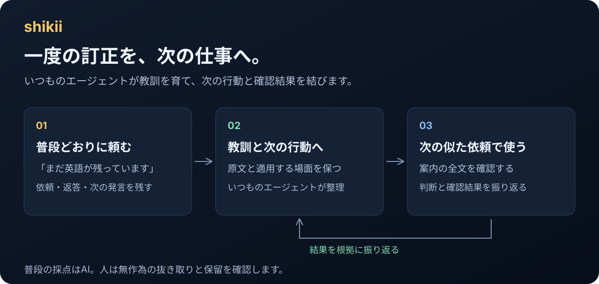

[English](../../README.md) · **日本語** · [简体中文](README_zh.md) · [繁體中文](README_zh-TW.md) · [한국어](README_ko.md) · [Deutsch](README_de.md) · [Español](README_es.md) · [Français](README_fr.md) · [Italiano](README_it.md) · [Português (Brasil)](README_pt-BR.md) · [Русский](README_ru.md) · [Українська](README_uk.md) · [Polski](README_pl.md) · [Türkçe](README_tr.md) · [Tiếng Việt](README_vi.md) · [Bahasa Indonesia](README_id.md)

<p align="center"></p>

# shikii: AIの「たぶん」を「任せてよい」に変える

モデルは確率を返します。shikiiは、その確率で動いてよいかを答えます。人と結果が付けた正解から線を引き、すべての判断を帯（`act` / `ask` / `discard`）にし、学んだことをエージェントが仕事中に使うwikiに貯め、人の訂正は次の仕事で機械が止める検査にします。

[](../../go.mod)
[](../../.github/workflows/test.yml)
[](../../LICENSE)
[](../decision-ops-framework.md)
[](../../CHANGELOG_ja.md)

0.7は線と帯の原点に戻った版です。推奨のモデルはTypeSafeのJevで、環境変数に鍵を置くだけで取得するものは無く、1問 約0.2秒で答えます。鍵を置けない時は手元のllama.cppで同じ問いに答えます。新しい教訓はwikiのどこに差し込むか・既存の教訓と食い違わないかを決定モデルが見ます。0.7.3では、人の訂正を「止める検査」にし、サブエージェントにも教訓を届け、届いた教訓が行動を変えたかを本番で数えます。**0.6.0以前からの更新は、初期化済みの各プロジェクトの `.shikii/` の中を全部消して初期化し直します。** 残したいものは先に控えてください。[変更履歴](../../CHANGELOG_ja.md)をご覧ください。

[困りごと](#困りごと) · [shikiiがすること](#shikiiがすること) · [人がすること](#人がすること) · [必要なもの](#必要なもの) · [始め方](#始め方) · [一周の流れ](#一周の流れ) · [会話から学ぶ](#会話から学ぶ) · [記憶はプロジェクトのもの](#記憶はプロジェクトのもの) · [もっと読む](#もっと読む)

<p align="center"></p>

## 困りごと

AIに「この問い合わせは前のと同じ案件？」と聞くと「たぶん、0.9」と返ります。実際の仕事ではこれでは足りません。

- その0.9は、本当に10回に9回当たるのか
- モデルを替えた日から、こっそりずれ始めていないか
- 聞き方を少し変えると、精度はどう動くのか
- 誰も見ていないところで自分で決めた判断は、今も正しいのか

エージェントに仕事を頼む側にも、別の困りごとがあります。

- 一度直してもらったことを、次の仕事でまた直している
- 教訓を書き残しても、エージェントが読んでいるのか、読んで行動が変わったのかが分からない
- サブエージェントに任せた仕事には、その教訓がそもそも届かない

人が全部の答えを確かめ、全部の訂正を繰り返すなら、AIを使う意味がほとんどありません。

## shikiiがすること

1. **答えを集めて、AIが自分で動いてよい線を引きます。** 人が付けた正解と、自動で観測できる結果から、モデルの自信と当たる割合の関係を測ります。線が引けるまで `act` は出ません。
2. **すべての判断を帯にします。** `act` は自動で進める、`ask` は人に確かめる、`discard` は動かない、`abstain` は入力か接続先が足りない。自動の判断には、何件の正解と人の確認で線を引いたかの記録が付きます。
3. **別の聞き方を試して、良い方を残します。** 同じ正解で、質問・選択肢の説明・配置の候補を採点します。人は、意味が変わっていないかを確かめて採用か却下を押すだけです。
4. **モデルを替えても最初からやり直しません。** 正解はモデルと別に残ります。推奨はTypeSafeのJevです。このプロジェクトの記事と答えで試すと、教訓の差し込み先・矛盾・依頼に効く教訓の見分けは、手元のモデルよりJevの方がはっきり分かれました（[測った数字](../guide.ja.md#jevと手元のモデルの比較)）。鍵を置けない時は手元のTernary-Bonsai-27Bです。普通のチャット用モデルですが、`shikii-readout` が選択肢の文字の確率を読んで決定モデルにし、1問 約0.6秒で答えます。
5. **学んだことを、エージェントが使うwikiに貯めます。** 依頼・返答・訂正が出典付きの教訓になります。新しい教訓を保存する前に、決定モデルが差し込み先の記事を探し、食い違いの疑いを出します。エージェントがどこへ足したかが、その判定の正解として自動で残り、人は答えません。似た依頼の前に教訓が届き、0.7.3からはサブエージェントが始まる時にも親の依頼に近い教訓が届きます。
6. **人の訂正を「止める検査」にします。** 「変更履歴は英語と日本語を揃える」「この語は使わない」「コミット本文に元の問題と検証を書く」のように機械で確かめられる訂正は、ターンの終わりに走る検査になります。引っかかるとエージェントは終われず、直してから終えます。repoを読めば分かる教訓を届けても行動は変わりませんでした（5課題で4つが同点）が、エージェントが知り得ない決まりは届けば6回中6回守られました。検査は、モデルが決まりを知らなくても6回中6回直させました。
7. **届いた教訓が行動を変えたかを、本番で数えます。** 振り返りで「役立った・使わなかった・害があった・不明」が付き、`shikii status` に届けた数と結果、止めた検査の数と直った数が出ます。合成の実験ではなく、実際の仕事で測ります。

## 人がすること

- **何を決めたいかを書く。** 判定のファイルに質問・選択肢・入力・しきい値を書きます（`shikii new`、または[既製の判定](../../decisions/README.md)を写す）。
- **いくつかの答えを付ける。** 画面には、モデルが迷った判断と、自動で進めた判断の20件に1件が並びます。本当はどうだったかのボタンを押します。観測できる結果（戻された変更、言い直された依頼、統合された教訓）は機械が答えます。
- **たまに聞き方を確かめる。** より良い聞き方が見つかったら、同じことを聞いているかを見て、採用か却下を押します。
- **普段どおりエージェントを訂正する。** 会話の中で「まだ英語が残っている」と言えば十分です。エージェントが教訓にし、shikiiが正しい記事の隣に置きます。機械で確かめられる訂正なら、エージェントが止める検査の草稿（無効）も置きます。
- **止める検査を有効にする。** `shikii guard enable <id>` を一度打ちます。shikiiは、その検査がわざと壊した例で実際に止まり、正しい例で通ることを見せてから有効にします。外すのも人の判断です。

それ以外は機械の仕事です。

## 必要なもの

| やりたいこと | 必要なもの |
|---|---|
| 普段の会話から学び、訂正を検査にする | Claude CodeまたはCodex、shikii、利用するプロジェクトでの `shikii --init`。サブエージェントへの配送はClaude Codeだけ |
| 既製の問いに答えさせる | 推奨: TypeSafeのJev（環境変数 `TYPESAFE_API_KEY`。取得するものは無い）。鍵を置けない時: llama.cpp（`llama-server`）とTernary-Bonsai-27Bを `shikii up` で立てる構成（取得 約7.6GB、動作中のメモリ約10GB） |
| 業務の判定に別のモデルを使う | 下の表のSystem One形式の接続先 |
| ソースからインストールする | Go 1.27以上、Git、sh。画面は同梱済みでNode.jsは不要 |
| コンテナで業務のAPIと画面を動かす | DockerとCompose、またはPodmanとCompose provider（[準備](../../integrations/docker.md)） |
| 鍵やGPUなしで一周試す | Go 1.27以上と同梱の偽モデル（`scripts/demo.sh`） |

| 接続先 | 準備するもの |
|---|---|
| Jev（TypeSafe AI） | 推奨。`TYPESAFE_API_KEY`。鍵があれば、既製の問いと、`send_to` に `hosted` を含む業務の判定がここへ送られる。1問 約0.2秒。[公式仕様](https://docs.typesafe.ai/introduction/quickstart) |
| llama.cpp | 鍵を置けない時。通常のチャットGGUFを同梱の `shikii-readout` 越しに（手元の標準はTernary-Bonsai-27B。`shikii up` が両方を立てる）。OpenJevのような学習済みの決定モデルはそのまま通す。Kev-4Bは使えない。[実行例](../../integrations/readout.md) |
| Ollama / LM Studio | `/v1/systemone` と決定モデル。業務の判定向け。この版では未検証 |

## 始め方

### 1. TypeSafeの鍵を置く（推奨）

[TypeSafe AI](https://docs.typesafe.ai/introduction/quickstart)でAPIの鍵を取得し、シェルとエージェントの環境変数に置きます（`export TYPESAFE_API_KEY=…`）。取得するものはなく、普通のPCで動きます。鍵があれば、hookも既製の問いもJevへ送り、手元のモデルは起こしません（`shikii up` も起こしません）。既製の問いのために、依頼文・エージェントの返答・wikiの教訓がTypeSafeへ送られます（手元の記録にも残ります）。鍵を置いたまま手元のモデルを使うなら `SHIKII_MODEL=local`、Jevに固定するなら `SHIKII_MODEL=hosted` を置きます。

**鍵を置けない時はllama.cppです。** 鍵が無ければ手元のモデルを動かします。27Bのモデルなので動作中のメモリが約10GB要り、普通のPCでは重いことがあります。macOSでHomebrewなら:

```sh
brew install go llama.cpp
go version            # 1.27以上
llama-server --version
```

macOS以外は[llama.cppの公式の手順](https://github.com/ggml-org/llama.cpp/blob/master/docs/install.md)を参照してください。手元の基本モデルは **Ternary-Bonsai-27B Q2_g64**（`prism-ml/Ternary-Bonsai-27B-gguf`、Apache 2.0。取得は約7.6GB、動作中のメモリは約10GB）です。`shikii up` がllama-serverを `:8086` に、`shikii-readout` を `:8080` に立てるので、hook・MCP・画面は常に `:8080` を見ます。他のGGUFも同じ形で使えます（`shikii up --gguf <file>`）。

### 2. shikiiをインストールする

```sh
curl -fsSL https://raw.githubusercontent.com/hayaenfj/shikii/main/install.sh | sh
```

インストーラーはソースから組むので、Go 1.27以上とGitが要ります。cloneした中なら `sh install.sh` です。実行ファイル、hook（依頼の前・作業の後・サブエージェントの開始）、エージェントの作法を入れ、PATHに足す必要があれば案内します。Codexでは一度 `/hooks` でhookを信頼してください。

### 3. 利用するプロジェクトを初期化する

使いたいプロジェクトで、エージェントにこう頼みます。

> このプロジェクトでshikiiを使って

エージェントが `shikii --init` を実行します（自分で実行しても同じ）。初期化したプロジェクトだけで動きます。既製の問い・wiki・止める検査の置き場・MCPの設定（プロジェクトに `.mcp.json`・`.cursor/mcp.json`・`opencode.json` と `AGENTS.md` の節（`CLAUDE.md` だけのプロジェクトでは作りません）が足されます。Gitの除外に入るのは `.shikii/` だけです）・エージェントの作法が用意されます。`shikii doctor` で状態を確かめます。画面 http://127.0.0.1:8096 は最初の答え待ちが出た時にhookが立てます。先に開くなら `shikii serve --store ~/.shikii/agent --port 8096` を実行します。

### 更新

```sh
shikii update
```

最新の安定版を取得し、ハッシュを確かめ、shikiiとreadoutを置き換えます。**0.6.0以前からの更新は、初期化済みの各プロジェクトの `.shikii/` の中を全部消して初期化し直します。** 以前の会話・教訓・正解・較正は消えます。残したいものは先に控えてください。0.7.0以降からの更新では残ります。更新後は画面とMCPを再起動してください。

## 一周の流れ

cloneした中で（例の判定はインストーラーには入っていません）:

```sh
shikii new same-issue --from decisions/same-issue.yaml              # 例の判定を .shikii/decisions/ に写す
SHIKII_MODEL=local shikii up                                     # この例の問いは pii: true なので手元のモデルが要る。鍵があると up は SHIKII_MODEL=local の時だけ起こす
shikii decide .shikii/decisions/same-issue.yaml -i report1="…" -i report2="…" --local http://127.0.0.1:8080
#   → band=ask   （線がまだ無いので人が決める）
shikii serve --local http://127.0.0.1:8080                       # 答え合わせの画面: http://127.0.0.1:8095
#   正解が必要な数（eval.min_n）に届くと、線は自動で引かれる
shikii decide .shikii/decisions/same-issue.yaml -i report1="…" -i report2="…" --local http://127.0.0.1:8080
#   → band=act   記録付き: 何件の正解、何件を人が確かめ、act側の精度はいくつか
```

| 帯 | すること |
|---|---|
| `act` | 線の条件を満たしたので自動で進める |
| `ask` | 人に確かめる |
| `discard` | 動かない |
| `abstain` | 足りない入力か接続先を揃える |

線は質問とモデルの組ごとに持ち、どちらかが変われば測り直します。`shikii tune` は貯めた正解で別の聞き方を採点し、`shikii drift` と `shikii check` はずれたモデルや弱められた線を捕まえます。鍵やGPUなしで試すなら、cloneした中で `scripts/demo.sh` を実行します。

- [既製の判定](../../decisions/README.md) · [業務の例](../examples/inquiry-route.md) · [全コマンドとHTTP API](../guide.ja.md) · [MCP](../../integrations/mcp.md) · [測った数字](../bench.md)

## 会話から学ぶ

hookを入れると、毎回のターンの2つの瞬間が残ります。エージェントが始める前の依頼と、終えた後の返答と変わったファイルです。次の人の発言が一組を閉じます。エージェントはそこから出典付きの教訓を書き、shikiiは似た仕事の前に関係する教訓を最大2件届け、サブエージェントが始まる時にも親の依頼に近い教訓を届けます。エージェントは振り返りで、届いた教訓が役立ったかを報告します。

<p align="center"></p>

決定モデルは、エージェント自身の仕事についての既製の問い（依頼の種類、先に進め方を合わせるべきか、変更が範囲内か、依頼を終えたか）に答え、新しい教訓の差し込み先と矛盾にも答えます。これらの正解は、その後に起きたことから付きます。次の依頼の間に戻された変更、言い直された依頼、統合・置き換えされた教訓です。結果が答えられない問いだけが人を待ち、その数は画面に出ます。

**止める検査**は、決定モデルではなく決まった規則です。ターンの終わりに、変わったファイル・足した行・そのターンのコミットに当てます。種類は3つです。

| 種類 | 止める時 | 例 |
|---|---|---|
| `paired-files` | 片方のファイルが変わったのに、もう片方が変わっていない | `CHANGELOG.md` と `CHANGELOG_ja.md` |
| `forbidden-words` | 足した行に使わないと決めた語がある | 言い換えを決めた語。例外のパスは見ない |
| `commit-body` | そのターンのコミットの本文に決めた語が無い | 「元の問題」「変更後」「検証」 |

エージェントは訂正から草稿を置き（`shikii guard add`、無効）、人が `shikii guard enable <id>` で有効にします。有効にする時、shikiiはその検査がわざと壊した例で止まることと、正しい例で通ることを先に見せます。引っかかったターンはエージェントが終われず、直してから終えます。止めた後の続きでは二度と止めず、直ったかだけを記録します。

| 仕事 | 普段の担当 | 人の分 |
|---|---|---|
| 会話からの教訓 | いつものエージェント | 普段の会話で訂正する |
| 教訓の差し込み先、範囲、完了 | 決定モデル。正解は結果から | 抜き取りと保留を確かめる |
| 止める検査 | 決まった規則。草稿はエージェント | 有効にするか決める |
| 業務の正解と聞き方の意味 | 人 | 正解を付け、採用の前に意味を確かめる |

効いているかは `shikii status` で見ます。届けた教訓の数と「役立った・使わなかった・害があった・不明」、止めた検査の数と直った数、人が答えた判定の数です。

[Andrej KarpathyのLLM Wiki](https://gist.github.com/karpathy/442a6bf555914893e9891c11519de94f)の考え方に沿い、原資料を残してエージェントが取り込み・検索・見直しを担います。詳しくは[hook](../../integrations/claude-code.md)、[wikiの作法](../../skills/shikii/references/wiki.md)、[止める検査の作法](../../skills/shikii/references/guards.md)。

## 記憶はプロジェクトのもの

会話・教訓・仮採点・正解・較正・止める検査は、そのプロジェクトの `.shikii/` に入ります。関係ないプロジェクトとは分かれます。共通の `~/.shikii/agent` には雛形・道具・プロジェクトの一覧があります。`.shikii/` には私的な会話が入るので、初期化がGitの未追跡ファイルから除きます。

<p align="center"></p>

```text
.shikii/
  decisions/  決定モデルへの問い
  wiki/       教訓・条件・以前の版
  guards/     人の訂正から作った止める検査
  records/    会話・判定・採点・配送・観察・検査の結果
  labels/     人と結果が付けた正解
```

## もっと読む

- [ガイド](../guide.ja.md): 全コマンド、HTTP API、モデルの接続、測った数字
- [構造の説明](../architecture.md)
- [エージェントの作法](../../skills/shikii/SKILL.md)
- [変更履歴](../../CHANGELOG_ja.md)

**開発に加わる人へ**: テストはわざと壊して落ちるのを見てから直します。観察と正解を分け、数字は測ったものだけを書きます。設定を増やすより、決まった置き場と規則で済ませます。

## ライセンス

[Apache-2.0 OR MIT](../../LICENSE)。[Apache 2.0](../../LICENSE-APACHE)か[MIT](../../LICENSE-MIT)を選べます。第三者の依存・同梱コード・モデル・外部サービスのライセンスは別です。配布物には3つのライセンスファイルと第三者の表示を含めてください。
